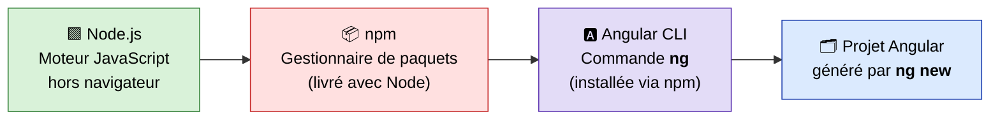
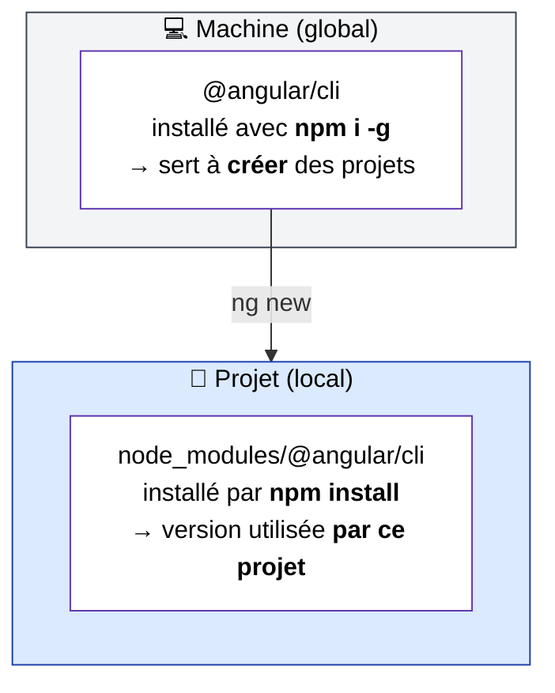
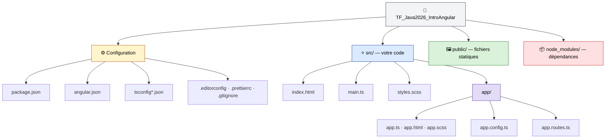
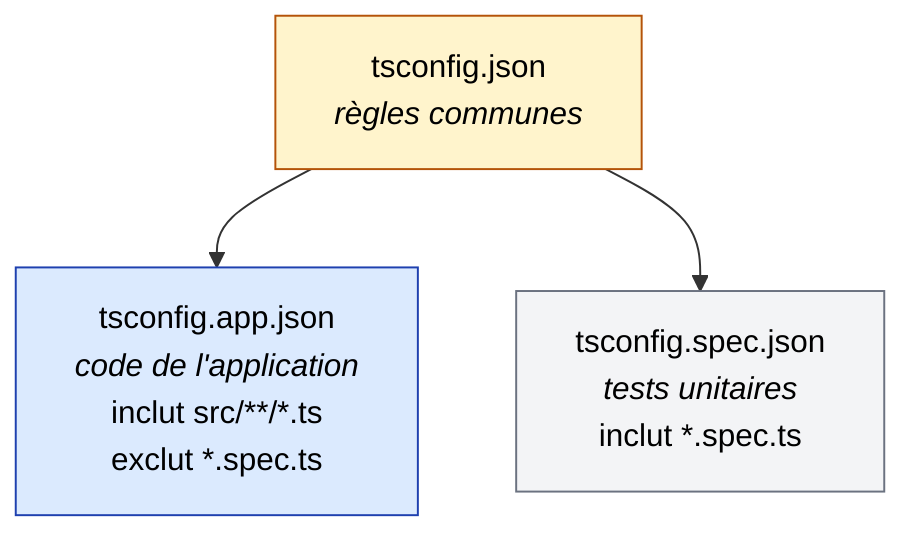
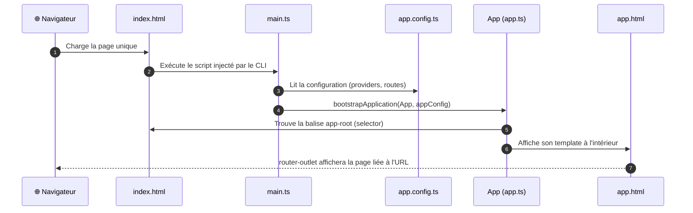
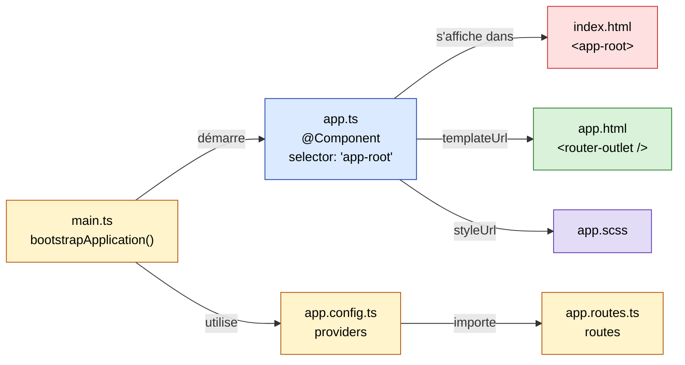

# 00 – Introduction : installer son environnement et créer un projet Angular

> 🎯 **Objectifs de ce chapitre**
> - Installer **Node.js** et **npm**
> - Installer l'**Angular CLI** en global
> - Créer un projet avec `ng new` et connaître ses options utiles
> - Comprendre **chaque fichier** d'un projet Angular fraîchement généré
> - Comprendre **comment l'application démarre** (du `index.html` jusqu'au composant `App`)

Versions utilisées pendant la formation :

| Outil         | Version |
| ------------- | ------- |
| Node.js       | 24.x    |
| npm           | 11.x    |
| Angular / CLI | 22.x    |
| TypeScript    | 6.0.x   |

---

## 1. La chaîne d'outils : qui fait quoi ?

Avant d'installer quoi que ce soit, il faut comprendre le rôle de chaque outil.



- **Node.js** : permet d'exécuter du JavaScript sur votre machine (et pas seulement dans un navigateur). Les outils Angular (compilateur, serveur de dev…) sont écrits en JavaScript, ils ont donc besoin de Node.
- **npm** (*Node Package Manager*) : télécharge et gère les librairies (« paquets »). C'est l'équivalent de **Maven / Gradle** pour le monde Java.
- **Angular CLI** (`ng`) : l'outil en ligne de commande d'Angular. Il crée des projets, génère du code, lance le serveur, compile…

> 💡 **Analogie Java**
> `package.json` ≈ `pom.xml` · `node_modules/` ≈ le dossier `.m2` (mais **local au projet**) · `npm install` ≈ `mvn install`

---

## 2. Installer Node.js

1. Aller sur **https://nodejs.org**
2. Télécharger la version **LTS** (*Long Term Support*) — c'est la version stable recommandée.
3. Lancer l'installeur et garder les options par défaut.
4. **Fermer et rouvrir** le terminal (pour qu'il prenne en compte le nouveau `PATH`).

Vérifier l'installation :

```bash
node -v
```

```bash
npm -v
```

Vous devez obtenir quelque chose comme `v24.21.0` et `11.14.1`.

> ⚠️ Angular ne supporte que certaines versions de Node. En cas de doute, consultez le tableau de compatibilité : https://angular.dev/reference/versions

---

## 3. Installer l'Angular CLI en global

```bash
npm install -g @angular/cli
```

- `install` (ou `i`) : installe un paquet
- `-g` : **global** → le paquet est installé une seule fois sur la machine, et la commande `ng` devient disponible **dans n'importe quel dossier**.

Vérifier :

```bash
ng version
```

> 🪟 **Windows / PowerShell** : si vous obtenez l'erreur *« l'exécution de scripts est désactivée sur ce système »*, exécutez une fois (dans PowerShell) :
> ```powershell
> Set-ExecutionPolicy -Scope CurrentUser -ExecutionPolicy RemoteSigned
> ```

### Global vs local : quelle différence ?



Le CLI global sert surtout à lancer `ng new`. Une fois **dans** le projet, `ng` utilise automatiquement la version locale déclarée dans `package.json`. Ainsi, chaque projet garde sa propre version d'Angular.

---

## 4. Créer un projet : `ng new`

La commande utilisée pour notre démo :

```bash
ng new TF_Java2026_IntroAngular --skip-tests
```

Le CLI pose ensuite quelques questions :

| Question | Notre choix | Explication |
| --- | --- | --- |
| Which stylesheet format would you like to use? | **SCSS** | CSS avec super-pouvoirs (variables, imbrication…) |
| Do you want to enable Server-Side Rendering (SSR)? | **No** | Le rendu côté serveur n'est pas nécessaire pour débuter |
| Which AI tools do you want to configure? | **None** | Fichiers de config pour assistants IA (optionnel) |

Puis il :
1. crée le dossier du projet et tous les fichiers ;
2. lance `npm install` (télécharge les dépendances dans `node_modules/`) ;
3. initialise un dépôt **Git** avec un premier commit.

### Options pratiques de `ng new`

Toutes les options peuvent être passées directement pour éviter les questions.

| Option | Effet |
| --- | --- |
| `--skip-tests` | ✅ *(utilisée en démo)* Ne génère **aucun** fichier `.spec.ts`, ni maintenant ni plus tard lors des `ng generate` (c'est enregistré dans `angular.json`) |
| `--style=scss` | Choisit le format des styles : `css`, `scss`, `sass`, `less` |
| `--ssr` / `--no-ssr` | Active / désactive le rendu côté serveur |
| `--routing` | Ajoute la configuration du routeur (activé par défaut) |
| `--prefix=xyz` | Préfixe des sélecteurs de composants (`app-` par défaut → `<app-header>`) |
| `--directory=mon-dossier` | Nom du dossier créé (par défaut : le nom du projet) |
| `--skip-install` | Ne lance pas `npm install` (à faire soi-même ensuite) |
| `--skip-git` | N'initialise pas de dépôt Git |
| `--inline-style` (`-s`) | Styles écrits **dans** le fichier `.ts` au lieu d'un fichier séparé |
| `--inline-template` (`-t`) | Template HTML écrit **dans** le fichier `.ts` |
| `--minimal` | Projet minimal : pas de tests, styles et templates inline |
| `--defaults` | Répond automatiquement aux questions avec les valeurs par défaut |
| `--dry-run` (`-d`) | **Simulation** : affiche ce qui serait créé sans rien écrire sur le disque |
| `--package-manager=npm` | Choisit le gestionnaire : `npm`, `yarn`, `pnpm`, `bun` |

Exemple « tout en une ligne », sans aucune question :

```bash
ng new mon-app --skip-tests --style=scss --no-ssr --defaults
```

> 💡 Pour voir toutes les options : `ng new --help`

### Lancer le projet

```bash
cd TF_Java2026_IntroAngular
```

```bash
ng serve -o
```

- `ng serve` compile l'application et démarre un **serveur de développement** sur http://localhost:4200
- `-o` (`--open`) ouvre automatiquement le navigateur
- Le serveur **recharge la page automatiquement** à chaque sauvegarde de fichier (*hot reload*)
- `Ctrl + C` dans le terminal pour l'arrêter

`npm start` fait exactement la même chose (voir la section `scripts` du `package.json`).

---

## 5. Le projet tel qu'il est après génération

Voici l'arborescence obtenue juste après `ng new ... --skip-tests` :

```text
TF_Java2026_IntroAngular/
├── .vscode/                  ← config VS Code (extensions, debug, tâches)
│   ├── extensions.json
│   ├── launch.json
│   └── tasks.json
├── node_modules/             ← dépendances téléchargées (NE PAS versionner)
├── public/                   ← fichiers statiques copiés tels quels
│   └── favicon.ico
├── src/                      ← ⭐ VOTRE CODE
│   ├── app/
│   │   ├── app.config.ts     ← configuration de l'application (providers)
│   │   ├── app.html          ← template du composant racine
│   │   ├── app.routes.ts     ← définition des routes
│   │   ├── app.scss          ← styles du composant racine
│   │   └── app.ts            ← composant racine (classe TypeScript)
│   ├── index.html            ← LA page HTML unique de l'application
│   ├── main.ts               ← point d'entrée : démarre Angular
│   └── styles.scss           ← styles globaux
├── .editorconfig             ← règles de formatage communes aux éditeurs
├── .gitignore                ← fichiers ignorés par Git
├── .prettierrc               ← config du formateur Prettier
├── angular.json              ← config du CLI (build, serve, schematics)
├── package.json              ← dépendances + scripts npm
├── package-lock.json         ← versions exactes installées
├── README.md
├── tsconfig.json             ← config TypeScript commune
├── tsconfig.app.json         ← config TypeScript de l'application
└── tsconfig.spec.json        ← config TypeScript des tests
```

Vue d'ensemble par rôle :



> 🧭 **Règle d'or** : au quotidien, vous travaillerez presque exclusivement dans **`src/app/`**. Les fichiers de configuration se touchent rarement.

---

### 5.1 Les fichiers de configuration (racine)

#### `package.json` — la carte d'identité du projet

```json
{
  "name": "tf-java2026-intro-angular",
  "version": "0.0.0",
  "scripts": {
    "ng": "ng",
    "start": "ng serve",
    "build": "ng build",
    "watch": "ng build --watch --configuration development",
    "test": "ng test"
  },
  "private": true,
  "dependencies": {
    "@angular/common": "^22.2.0",
    "@angular/compiler": "^22.2.0",
    "@angular/core": "^22.2.0",
    "@angular/forms": "^22.2.0",
    "@angular/platform-browser": "^22.2.0",
    "@angular/router": "^22.2.0",
    "rxjs": "~7.8.0",
    "tslib": "^2.3.0"
  },
  "devDependencies": {
    "@angular/build": "^22.2.2",
    "@angular/cli": "^22.2.2",
    "@angular/compiler-cli": "^22.2.0",
    "prettier": "^3.8.1",
    "typescript": "~6.0.2"
  }
}
```

- **`scripts`** : raccourcis lancés avec `npm run <nom>` (ex. `npm run build`). `start` et `test` peuvent s'écrire sans `run` : `npm start`.
- **`dependencies`** : librairies nécessaires **à l'exécution** de l'application (elles finissent dans le code livré au navigateur).
  - `@angular/core` : le cœur (composants, signals, injection de dépendances…)
  - `@angular/common` : outils communs (pipes, `HttpClient`…)
  - `@angular/router` : la navigation entre pages
  - `@angular/forms` : la gestion des formulaires
  - `@angular/platform-browser` : le lancement de l'app dans un navigateur
  - `rxjs` : la programmation réactive (Observables)
- **`devDependencies`** : outils utiles **uniquement pendant le développement** (compilateur, CLI, TypeScript, Prettier).

> 🔢 **Lire les versions**
> - `^22.2.0` → accepte toute version `22.x.x` ≥ 22.2.0 (mises à jour mineures OK)
> - `~7.8.0` → accepte `7.8.x` uniquement (correctifs seulement)
> - La version **exacte** réellement installée est notée dans `package-lock.json`.

> 💡 Après un `git clone`, le dossier `node_modules/` est absent (il est dans `.gitignore`). Il suffit de lancer `npm install` pour le recréer à partir du `package.json`.

#### `angular.json` — la configuration du CLI

C'est le fichier lu par les commandes `ng serve`, `ng build`, `ng generate`… Trois parties à retenir :

**① `schematics` : les valeurs par défaut de `ng generate`**

```json
"schematics": {
  "@schematics/angular:component": {
    "style": "scss",
    "skipTests": true
  },
  "@schematics/angular:service": {
    "skipTests": true
  },
  ...
}
```

C'est ici que l'option `--skip-tests` a laissé sa trace : pour **chaque** type d'élément (composant, service, pipe, guard…), Angular ne générera plus de fichier `.spec.ts`. Idem pour `"style": "scss"` : chaque nouveau composant aura un fichier `.scss`.

**② `architect.build` : comment compiler**

```json
"build": {
  "builder": "@angular/build:application",
  "options": {
    "browser": "src/main.ts",
    "tsConfig": "tsconfig.app.json",
    "assets": [{ "glob": "**/*", "input": "public" }],
    "styles": ["src/styles.scss"]
  },
  ...
}
```

- `browser` : le **point d'entrée** de l'application → `src/main.ts`
- `assets` : tout le contenu de `public/` est copié tel quel
- `styles` : les feuilles de style **globales** (on ajoutera ici Bootstrap, par exemple)

**③ `configurations` : production vs développement**

- `production` (par défaut pour `ng build`) : code optimisé, minifié, noms de fichiers avec *hash* et **budgets** (alerte si le bundle dépasse 500 kB, erreur au-delà de 1 MB).
- `development` (par défaut pour `ng serve`) : pas d'optimisation, *source maps* activées pour pouvoir déboguer le TypeScript dans le navigateur.

#### `tsconfig.json`, `tsconfig.app.json`, `tsconfig.spec.json`

Configuration du compilateur **TypeScript**.



Les deux fichiers spécialisés **héritent** (`"extends"`) du fichier commun. Quelques options intéressantes de `tsconfig.json` :

- `"target": "ES2022"` : version de JavaScript produite
- `"noImplicitReturns": true` : erreur si une fonction ne retourne pas une valeur dans tous les cas
- `"noFallthroughCasesInSwitch": true` : erreur si un `case` oublie son `break`
- `"strictInjectionParameters": true` (option Angular) : erreur si une dépendance ne peut pas être injectée

> 📝 Comme on a utilisé `--skip-tests`, `tsconfig.spec.json` ne nous servira pas dans cette formation.

#### Les petits fichiers utilitaires

| Fichier | Rôle |
| --- | --- |
| `.editorconfig` | Règles d'édition partagées entre IDE : UTF-8, indentation de **2 espaces**, guillemets simples en TS |
| `.prettierrc` | Config de **Prettier** (formateur auto) : lignes de 100 caractères max, guillemets simples |
| `.gitignore` | Ce que Git ignore : `node_modules/`, `dist/`, `.angular/cache`, `.idea/`… |
| `.vscode/` | Extension recommandée (*Angular Language Service*) + configs pour lancer/déboguer `ng serve` depuis VS Code |
| `README.md` | Aide-mémoire des commandes du CLI |
| `public/favicon.ico` | L'icône affichée dans l'onglet du navigateur |

> 📂 Deux dossiers apparaîtront aussi au fil du temps : **`.angular/`** (cache de compilation) et **`dist/`** (résultat de `ng build`). Tous deux sont ignorés par Git.

---

### 5.2 Le dossier `src/` : le démarrage de l'application

Angular produit une **SPA** (*Single Page Application*) : il n'existe **qu'une seule page HTML**. C'est ensuite Angular qui modifie dynamiquement son contenu.

#### `src/index.html` — l'unique page HTML

```html
<!doctype html>
<html lang="en">
<head>
  <meta charset="utf-8">
  <title>TFJava2026IntroAngular</title>
  <base href="/">
  <meta name="viewport" content="width=device-width, initial-scale=1">
  <link rel="icon" type="image/x-icon" href="favicon.ico">
</head>
<body>
  <app-root></app-root>
</body>
</html>
```

- `<app-root></app-root>` : une **balise inconnue** du HTML standard. C'est l'emplacement où Angular va afficher le **composant racine**.
- `<base href="/">` : indispensable au routeur pour construire les URL.
- Aucune balise `<script>` ? Normal : le CLI les injecte automatiquement lors de la compilation.

#### `src/main.ts` — le point d'entrée

```ts
import { bootstrapApplication } from '@angular/platform-browser';
import { appConfig } from './app/app.config';
import { App } from './app/app';

bootstrapApplication(App, appConfig)
  .catch((err) => console.error(err));
```

C'est **le premier code exécuté**. Il dit : *« Démarre l'application avec le composant `App` comme racine, et la configuration `appConfig` »*. C'est l'équivalent de la méthode `public static void main(String[] args)` en Java.

#### `src/styles.scss` — les styles globaux

```scss
/* You can add global styles to this file, and also import other style files */
```

Vide au départ. Les styles écrits ici s'appliquent à **toute** l'application (contrairement aux `.scss` des composants, qui ne s'appliquent qu'à leur propre composant).

---

### 5.3 Le dossier `src/app/` : le composant racine

#### `app.ts` — la classe du composant

```ts
import { Component, signal } from '@angular/core';
import { RouterOutlet } from '@angular/router';

@Component({
  imports: [RouterOutlet],
  selector: 'app-root',
  styleUrl: './app.scss',
  templateUrl: './app.html',
})
export class App {
  protected readonly title = signal('TF_Java2026_IntroAngular');
}
```

Un **composant** = une classe TypeScript **décorée** par `@Component`. Le décorateur (≈ une annotation Java) donne à Angular les métadonnées :

| Propriété | Rôle |
| --- | --- |
| `selector: 'app-root'` | Le nom de la balise HTML qui affiche ce composant → correspond au `<app-root>` de `index.html` |
| `templateUrl` | Le fichier HTML (la **vue**) du composant |
| `styleUrl` | Le fichier de styles propre au composant |
| `imports` | Les autres composants / directives / pipes **utilisés dans le template** (ici `RouterOutlet`) |

Dans la classe, `title` est un **signal** : une valeur réactive. Quand elle change, Angular met automatiquement l'affichage à jour (on y reviendra en détail).

#### `app.html` — le template

Après génération, ce fichier contient ~340 lignes de **page d'accueil de démonstration** (logo Angular, liens vers la doc…), encadrées par des commentaires explicites :

```html
<!-- * * * * * * * * * * * The content below * * * * * * * * * * * -->
<!-- * * * * * * * * * * is only a placeholder * * * * * * * * * * -->
<!-- * * * * * * * * * Delete the template below * * * * * * * * * -->
...
<router-outlet />
```

👉 Tout ce contenu est **à supprimer**. La seule ligne à garder (si on utilise le routeur) est **`<router-outlet />`** : c'est l'emplacement où s'afficheront les **pages** selon l'URL.

#### `app.scss` — les styles du composant

Vide au départ. Ces styles sont **encapsulés** : ils ne « fuient » pas vers les autres composants.

#### `app.config.ts` — la configuration de l'application

```ts
import { ApplicationConfig, provideBrowserGlobalErrorListeners } from '@angular/core';
import { provideRouter } from '@angular/router';
import { routes } from './app.routes';

export const appConfig: ApplicationConfig = {
  providers: [
    provideBrowserGlobalErrorListeners(),
    provideRouter(routes)
  ]
};
```

La liste des **providers** = les services/fonctionnalités disponibles dans toute l'application.
- `provideBrowserGlobalErrorListeners()` : capture les erreurs JavaScript non gérées.
- `provideRouter(routes)` : active le routeur avec les routes définies dans `app.routes.ts`.
- Plus tard, on ajoutera par exemple `provideHttpClient()` pour appeler une API.

#### `app.routes.ts` — les routes

```ts
import { Routes } from '@angular/router';

export const routes: Routes = [];
```

Un tableau **vide** pour l'instant. On y associera des URL (`/home`, `/about`…) à des composants.

---

## 6. Comment l'application démarre

Voici l'enchaînement complet entre le moment où l'utilisateur ouvre http://localhost:4200 et l'affichage :



Et la relation entre les fichiers :



---

## 7. Premier nettoyage

Avant de commencer à coder :

1. Ouvrir `src/app/app.html`
2. **Tout supprimer** sauf `<router-outlet />`
3. Sauvegarder → le navigateur se recharge et affiche une page blanche : on part d'une base propre ✅

---

## 📋 Aide-mémoire

| Commande | Rôle |
| --- | --- |
| `node -v` / `npm -v` | Vérifier les versions de Node / npm |
| `npm install -g @angular/cli` | Installer le CLI Angular en global |
| `ng version` | Afficher les versions d'Angular |
| `ng new <nom> --skip-tests` | Créer un projet sans fichiers de test |
| `npm install` | (Ré)installer les dépendances (après un `git clone`) |
| `ng serve -o` / `npm start` | Lancer le serveur de dev sur http://localhost:4200 |
| `ng build` | Compiler pour la production dans `dist/` |
| `ng generate --help` | Lister ce que le CLI peut générer |

## ✅ À retenir

- **Node + npm** sont les fondations ; le **CLI Angular** (`ng`) s'installe par-dessus, en global.
- `--skip-tests` est **mémorisé** dans `angular.json` : plus aucun `.spec.ts` ne sera généré.
- Une application Angular = **une seule page** (`index.html`) dans laquelle Angular affiche des **composants**.
- Le démarrage suit toujours : `index.html` → `main.ts` → `App` (+ `appConfig`).
- Un composant = **classe** (`.ts`) + **template** (`.html`) + **styles** (`.scss`), reliés par `@Component`.
- Votre terrain de jeu : **`src/app/`**.
