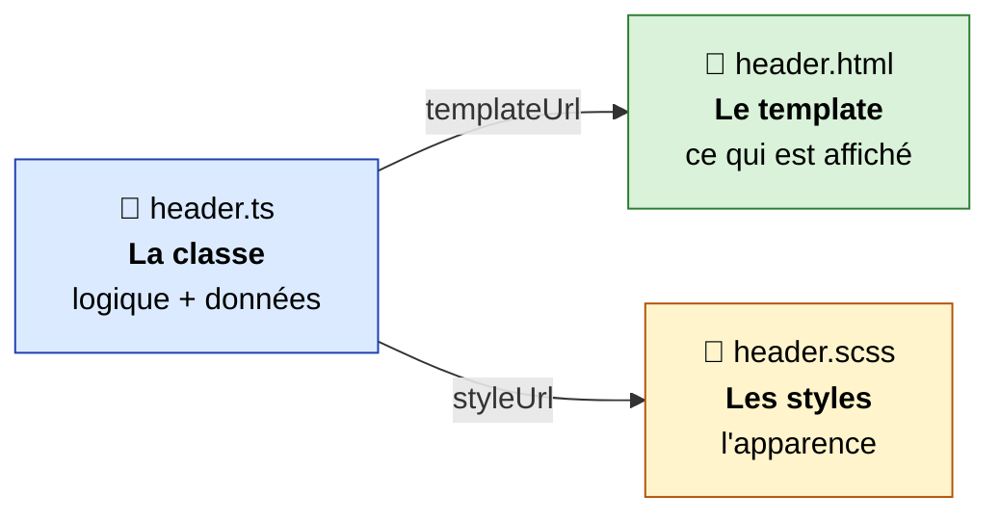
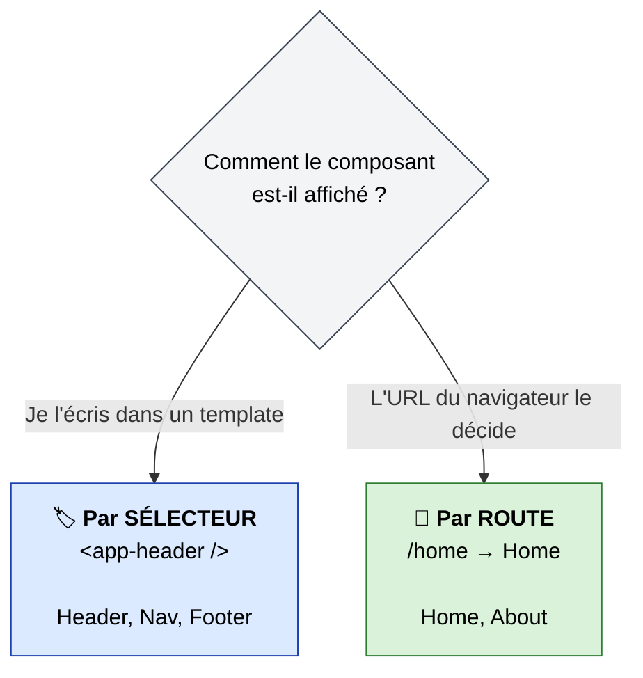
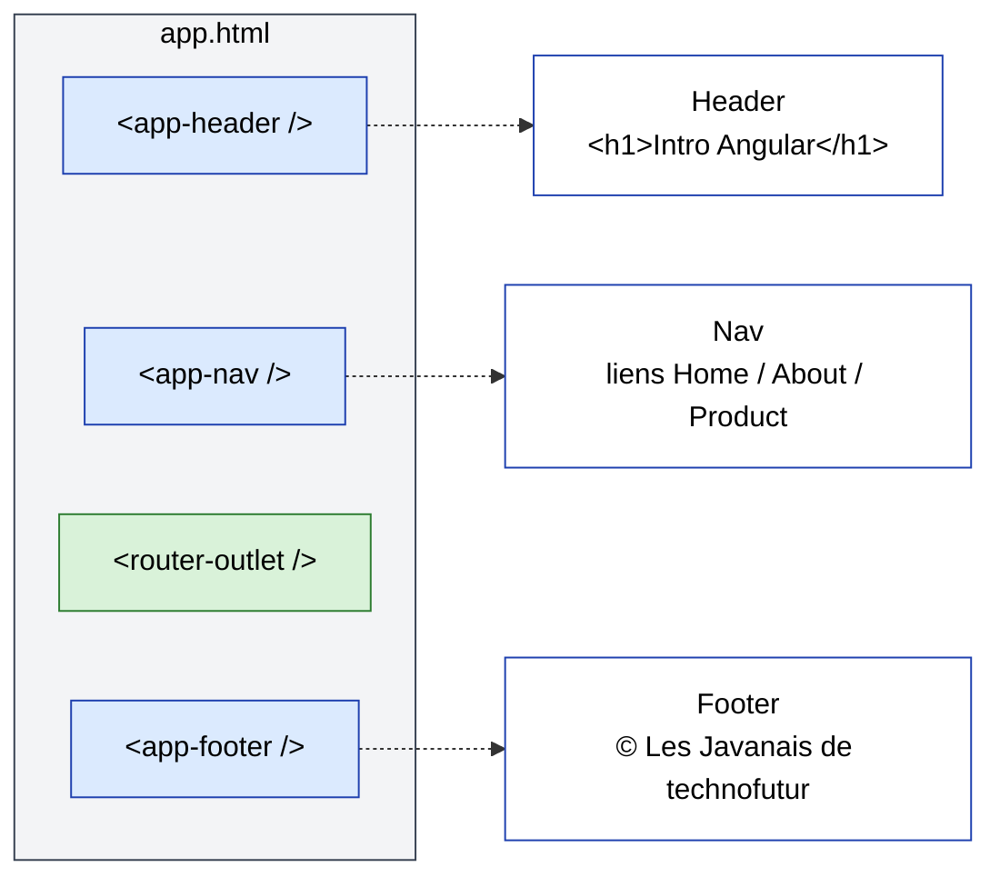
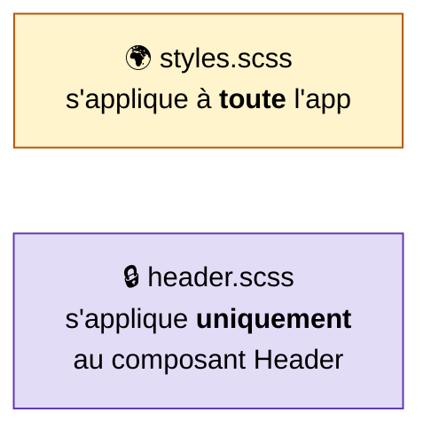
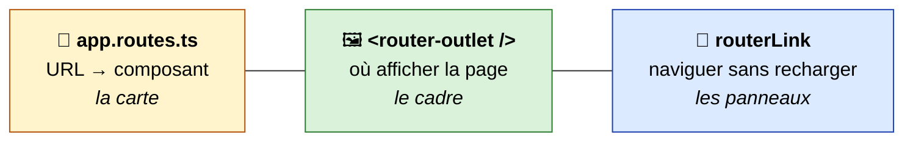
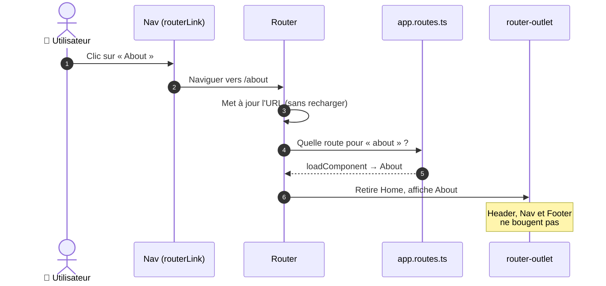
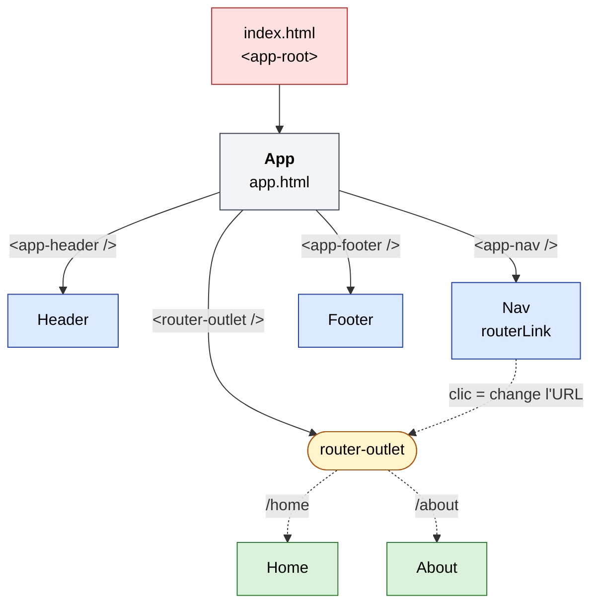

# 01 – Les composants (et une première approche du routing)

> 🎯 **Objectifs de ce chapitre**
> - Comprendre ce qu'est un **composant** et comment le générer
> - Savoir **afficher un composant via son sélecteur** (`<app-header />`)
> - Savoir **afficher un composant via une route** (`/home`)
> - Comprendre la différence entre les deux et **quand utiliser l'un ou l'autre**
> - Découvrir le routing : `app.routes.ts`, `<router-outlet />` et `routerLink`

Fichiers de la démo utilisés dans ce chapitre :

```text
src/app/
├── app.ts / app.html / app.scss    ← composant racine (le « squelette »)
├── app.routes.ts                   ← les routes
├── layout/                         ← composants appelés par SÉLECTEUR
│   ├── header/  (header.ts, header.html, header.scss)
│   ├── nav/     (nav.ts, nav.html, nav.scss)
│   └── footer/  (footer.ts, footer.html, footer.scss)
└── pages/                          ← composants appelés par ROUTE
    ├── home/    (home.ts, home.html, home.scss)
    └── about/   (about.ts, about.html, about.scss)
```

---

## 1. Qu'est-ce qu'un composant ?

Un **composant** est une **brique d'interface réutilisable**. Une application Angular est un **arbre de composants** : le composant racine `App` contient d'autres composants, qui peuvent eux-mêmes en contenir d'autres…

Un composant est toujours composé de **3 fichiers** :



> 💡 **Analogie Java** : la classe `.ts` joue le rôle d'un *contrôleur*, le `.html` celui d'une *vue* (comme une JSP / un template Thymeleaf), mais les deux sont **liés et livrés ensemble**.

### Générer un composant

On ne crée jamais ces fichiers à la main : on utilise le CLI.

```bash
ng generate component layout/header
```

Ou en version courte :

```bash
ng g c layout/header
```

Le chemin `layout/header` est relatif à `src/app/`. Le CLI crée le dossier et les 3 fichiers :

```text
CREATE src/app/layout/header/header.scss
CREATE src/app/layout/header/header.html
CREATE src/app/layout/header/header.ts
```

> 📝 Pas de `header.spec.ts` grâce à `--skip-tests` (voir chapitre 00), et un fichier `.scss` grâce à la config `"style": "scss"` de `angular.json`.

Commandes utilisées pour la démo :

```bash
ng g c layout/header
```
```bash
ng g c layout/nav
```
```bash
ng g c layout/footer
```
```bash
ng g c pages/home
```
```bash
ng g c pages/about
```

> 🗂️ **Organisation** : on range les composants par **rôle** — `layout/` pour les éléments fixes de la mise en page, `pages/` pour les écrans accessibles par une URL. Ce n'est pas imposé par Angular, mais c'est une convention très répandue qui rend le projet lisible.

### Anatomie de la classe

```ts
// src/app/layout/header/header.ts
import { Component } from '@angular/core';

@Component({
  imports: [],
  selector: 'app-header',
  styleUrl: './header.scss',
  templateUrl: './header.html',
})
export class Header {}
```

| Élément | Rôle |
| --- | --- |
| `@Component({...})` | Décorateur (≈ annotation Java) qui transforme une simple classe en composant Angular |
| `selector` | Le **nom de la balise HTML** qui permet d'afficher ce composant |
| `templateUrl` | Le fichier HTML du composant |
| `styleUrl` | Le fichier de styles du composant |
| `imports` | Ce que **le template** de ce composant utilise (autres composants, directives…) |
| `export class Header {}` | La classe ; elle contiendra plus tard les données et méthodes. `export` la rend importable ailleurs |

---

## 2. Deux façons d'afficher un composant

C'est **la** notion clé de ce chapitre :



---

## 3. Afficher un composant via son sélecteur

### Étape 1 : le composant déclare un sélecteur

```ts
// header.ts
@Component({
  selector: 'app-header',   // ← le nom de la balise
  ...
})
export class Header {}
```

```html
<!-- header.html -->
<h1>Intro Angular</h1>
```

### Étape 2 : le parent **importe** le composant

Pour pouvoir utiliser `<app-header />` dans `app.html`, le composant `App` doit **l'importer** à deux endroits :

```ts
// src/app/app.ts
import { Component, signal } from '@angular/core';
import { Header } from './layout/header/header';   // ① import TypeScript
import { Nav } from './layout/nav/nav';
import { Footer } from './layout/footer/footer';
import { RouterOutlet } from '@angular/router';

@Component({
  imports: [Header, Nav, Footer, RouterOutlet],      // ② import Angular
  selector: 'app-root',
  styleUrl: './app.scss',
  templateUrl: './app.html',
})
export class App {
  protected readonly title = signal('TF_Java2026_IntroAngular');
}
```

1. **`import { Header } from '...'`** (en haut du fichier) : l'import **TypeScript** classique, comme un `import` Java.
2. **`imports: [Header, ...]`** (dans `@Component`) : dit à **Angular** « le template de ce composant a le droit d'utiliser `Header` ».

> ⚠️ **Erreur classique** : oublier le tableau `imports`. Angular affiche alors l'erreur
> `NG8001: 'app-header' is not a known element`.
> 👉 Réflexe : *chaque balise de composant utilisée dans un template doit figurer dans les `imports` du composant parent.*

### Étape 3 : on utilise la balise dans le template du parent

```html
<!-- src/app/app.html -->
<header>
  <app-header />
</header>
<nav>
  <app-nav />
</nav>
<main>
  <router-outlet />
</main>
<footer>
  <app-footer />
</footer>
```

Angular remplace chaque balise par le **template** du composant correspondant :



> 💡 `<app-header />` est une balise **auto-fermante**, une syntaxe propre à Angular. `<app-header></app-header>` fonctionne aussi.

### Les sélecteurs utilisés dans la démo

| Composant | Sélecteur | Où est-il utilisé ? |
| --- | --- | --- |
| `App` | `app-root` | `index.html` |
| `Header` | `app-header` | `app.html` |
| `Nav` | `app-nav` | `app.html` |
| `Footer` | `app-footer` | `app.html` |

> 🔤 Le préfixe **`app-`** vient de l'option `prefix` de `angular.json`. Il évite les conflits avec les balises HTML natives (un composant nommé `header` entrerait en conflit avec la balise `<header>` !).

---

## 4. Les styles d'un composant

### Des styles encapsulés

Les styles d'un composant **ne s'appliquent qu'à son propre template**. Le `h1` stylé dans `header.scss` n'affectera aucun autre `h1` de l'application.

```scss
// header.scss
:host {
  background-color: darkcyan;
  display: flex;
  padding: 0.3rem;

  h1 {
    color: white;
    text-align: center;
    width: 100%;
  }
}
```

### Le sélecteur `:host`

`:host` désigne **la balise du composant elle-même**, c'est-à-dire `<app-header>`.

> ⚠️ Par défaut, une balise de composant se comporte comme un élément `inline` (comme un `<span>`). Pensez à lui donner un `display` (`block`, `flex`…) pour que `padding`, `background`, etc. s'appliquent correctement. C'est ce qu'on fait dans la démo :

```scss
// footer.scss
:host {
  display: block;
  padding: 0.3rem;

  p { text-align: center; }
}
```

```scss
// nav.scss
:host {
  display: flex;
  gap: 1rem;
  padding: 0.3rem;
}
```

### La mise en page globale dans `app.scss`

```scss
// app.scss
:host {
  display: flex;
  flex-direction: column;
  min-height: 100vh;

  main {
    flex: 1;          // le <main> prend toute la place restante
    padding: 0.3rem;
  }
}
```

Résultat : le footer reste **collé en bas** de l'écran, même si la page est presque vide.

### Les styles globaux dans `styles.scss`

Pour ce qui doit s'appliquer **partout**, on utilise `src/styles.scss` :

```scss
// styles.scss — un « reset » CSS
* {
  box-sizing: border-box;
  margin: 0;
  padding: 0;
}
```



---

## 5. Afficher un composant via une route

Certains composants ne doivent pas être affichés **en permanence**, mais **selon l'URL** : ce sont les **pages**.

| URL | Composant affiché |
| --- | --- |
| http://localhost:4200/home | `Home` |
| http://localhost:4200/about | `About` |

### 5.1 Le routing en 3 pièces



> ✅ La pièce n°0 est déjà en place depuis `ng new` : `provideRouter(routes)` dans `app.config.ts` active le routeur.

### 5.2 La carte : `app.routes.ts`

```ts
// src/app/app.routes.ts
import { Routes } from '@angular/router';

export const routes: Routes = [
  {
    path: '',
    redirectTo: '/home',
    pathMatch: 'full',
  },
  {
    path: 'home',
    loadComponent: () =>
      import('./pages/home/home').then(m => m.Home),
  },
  {
    path: 'about',
    loadComponent: () =>
      import('./pages/about/about').then(m => m.About),
  },
];
```

Chaque route est un objet :

| Propriété | Rôle |
| --- | --- |
| `path` | La partie de l'URL après `localhost:4200/` (**sans** `/` au début) |
| `loadComponent` | Le composant à afficher, chargé **à la demande** (voir ci-dessous) |
| `redirectTo` | Redirige vers une autre URL au lieu d'afficher un composant |
| `pathMatch: 'full'` | La redirection n'a lieu que si l'URL est **exactement** `''` |

**La route de redirection** : quand l'utilisateur arrive sur `http://localhost:4200/` (chemin vide), il est automatiquement envoyé vers `/home`.

> ⚠️ Avec `path: ''`, `pathMatch: 'full'` est **obligatoire**. Sans lui, Angular considérerait que *toutes* les URL commencent par `''`… et redirigerait tout vers `/home` !

#### `loadComponent` : le *lazy loading*

```ts
loadComponent: () => import('./pages/home/home').then(m => m.Home)
```

Se lit : *« quand on visite `/home`, va chercher le fichier `home.ts`, et prends-y la classe `Home` »*.

Le code de la page n'est **téléchargé par le navigateur qu'au moment où on la visite**. L'application démarre plus vite, car elle ne charge pas toutes les pages d'un coup.

Il existe aussi une forme plus simple, sans lazy loading :

```ts
import { Home } from './pages/home/home';

{ path: 'home', component: Home }
```

| | `component: Home` | `loadComponent: () => import(...)` |
| --- | --- | --- |
| Chargement | Au démarrage de l'application | Au premier accès à la page |
| Import en haut du fichier | Oui | Non |
| Recommandé pour | Petites apps, démos rapides | ✅ Les pages en général |

> 💡 On remarque que les composants de `pages/` **ne sont pas** dans les `imports` de `App`. C'est normal : c'est le **routeur** qui s'occupe de les charger, pas un template.

### 5.3 Le cadre : `<router-outlet />`

```html
<!-- app.html -->
<main>
  <router-outlet />
</main>
```

`<router-outlet />` est un **emplacement réservé** : le routeur y affiche le composant correspondant à l'URL courante. Tout le reste de `app.html` (header, nav, footer) reste **fixe**.

Pour l'utiliser, `App` doit importer `RouterOutlet` :

```ts
imports: [Header, Nav, Footer, RouterOutlet],
```

### 5.4 Les panneaux : `routerLink`

```html
<!-- src/app/layout/nav/nav.html -->
<a routerLink="/home">Home</a>
<a routerLink="/about">About</a>
```

```ts
// src/app/layout/nav/nav.ts
import { Component } from '@angular/core';
import { RouterLink } from '@angular/router';

@Component({
  imports: [RouterLink],        // ← nécessaire pour utiliser routerLink
  selector: 'app-nav',
  styleUrl: './nav.scss',
  templateUrl: './nav.html',
})
export class Nav {}
```

**Pourquoi pas un simple `href` ?**

| `<a href="/about">` | `<a routerLink="/about">` |
| --- | --- |
| Le navigateur **recharge toute la page** depuis le serveur | Angular **change seulement** le contenu du `<router-outlet />` |
| L'application redémarre, l'état est perdu | Instantané, l'état est conservé |
| ❌ À éviter pour la navigation interne | ✅ À utiliser pour naviguer dans l'app |

> ⚠️ `routerLink` est une **directive** : comme pour un composant, il faut l'ajouter dans les `imports` du composant qui l'utilise (ici `Nav`, pas `App` !). Si on l'oublie, il n'y a **pas d'erreur**… mais le lien ne fait rien.

> 💡 **Bonus** : la directive `routerLinkActive` ajoute une classe CSS sur le lien de la page courante, pratique pour le surligner :
> ```html
> <a routerLink="/home" routerLinkActive="active">Home</a>
> ```
> (à importer : `RouterLinkActive`)

### 5.5 Ce qui se passe quand on clique



---

## 6. Sélecteur ou route : le comparatif

### Le cas de `Home` : une page sans sélecteur

Regardez bien la classe `Home` de la démo :

```ts
// src/app/pages/home/home.ts
@Component({
  imports: [],
  // selector: 'app-home',
  styleUrl: './home.scss',
  templateUrl: './home.html',
})
export class Home {}
```

Le `selector` est **commenté**… et pourtant la page s'affiche parfaitement sur `/home` !

👉 **Un composant affiché par le routeur n'a pas besoin de sélecteur.** Le routeur le désigne par sa **classe** (`m.Home`), pas par une balise. Pour comparer, `About` a gardé son sélecteur `app-about` (généré par défaut), mais celui-ci n'est **jamais utilisé**.

Retirer le sélecteur d'une page est d'ailleurs une bonne pratique : on indique clairement que ce composant n'est **pas fait pour être inséré** dans un template.

### Tableau récapitulatif

| | 🏷️ Par sélecteur | 🧭 Par route |
| --- | --- | --- |
| Exemples de la démo | `Header`, `Nav`, `Footer` | `Home`, `About` |
| Dossier | `layout/` | `pages/` |
| Comment on l'affiche | En écrivant `<app-header />` dans un template | En visitant une URL (`/home`) |
| Qui décide de l'afficher ? | Le **template du parent** | Le **routeur**, selon l'URL |
| `selector` nécessaire ? | ✅ Oui | ❌ Non |
| Doit être dans les `imports` du parent ? | ✅ Oui | ❌ Non |
| Doit être déclaré dans `app.routes.ts` ? | ❌ Non | ✅ Oui |
| Où apparaît-il ? | À l'endroit exact de la balise | Dans le `<router-outlet />` |
| Durée de vie | Tant que le parent est affiché | Tant que l'URL correspond |

### Vue d'ensemble de la démo



🟦 Bleu : composants **par sélecteur** (toujours visibles) · 🟩 Vert : composants **par route** (un seul à la fois).

---

## 7. Récapitulatif pas à pas : ajouter une nouvelle page

Exemple : ajouter une page **Contact** accessible via `/contact`.

1. Générer le composant :
   ```bash
   ng g c pages/contact
   ```
2. (Optionnel) Supprimer la ligne `selector` dans `contact.ts`.
3. Déclarer la route dans `app.routes.ts` :
   ```ts
   {
     path: 'contact',
     loadComponent: () =>
       import('./pages/contact/contact').then(m => m.Contact),
   },
   ```
4. Ajouter le lien dans `nav.html` :
   ```html
   <a routerLink="/contact">Contact</a>
   ```
5. Tester : cliquer sur le lien, ou taper l'URL http://localhost:4200/contact.

Et pour ajouter un **élément de layout** (ex. une barre latérale) :

1. `ng g c layout/sidebar`
2. Importer `Sidebar` dans les `imports` de `App`
3. Placer `<app-sidebar />` dans `app.html`

---

## ✅ À retenir

- Un composant = **classe** + **template** + **styles**, reliés par `@Component`. On le crée avec `ng g c chemin/nom`.
- **Par sélecteur** : on écrit la balise (`<app-header />`) dans un template, et le composant doit figurer dans les `imports` du parent.
- **Par route** : on associe une URL à un composant dans `app.routes.ts`. Il s'affiche dans `<router-outlet />` et n'a **pas besoin de sélecteur**.
- `loadComponent` charge la page **à la demande** (*lazy loading*).
- `path: ''` + `redirectTo` + `pathMatch: 'full'` = page par défaut.
- On navigue avec **`routerLink`**, jamais avec `href`, et on n'oublie pas d'importer `RouterLink`.
- Les styles d'un composant sont **encapsulés** ; `:host` cible la balise du composant ; `styles.scss` sert aux styles globaux.
