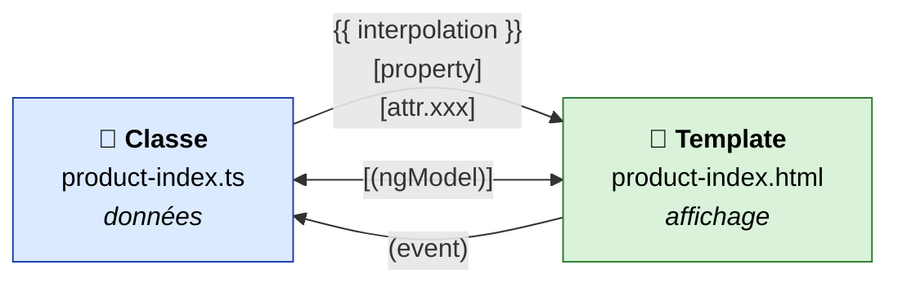
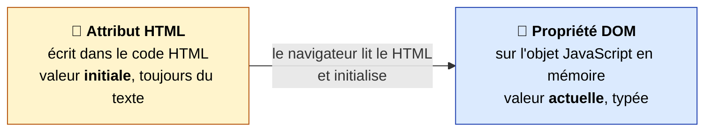
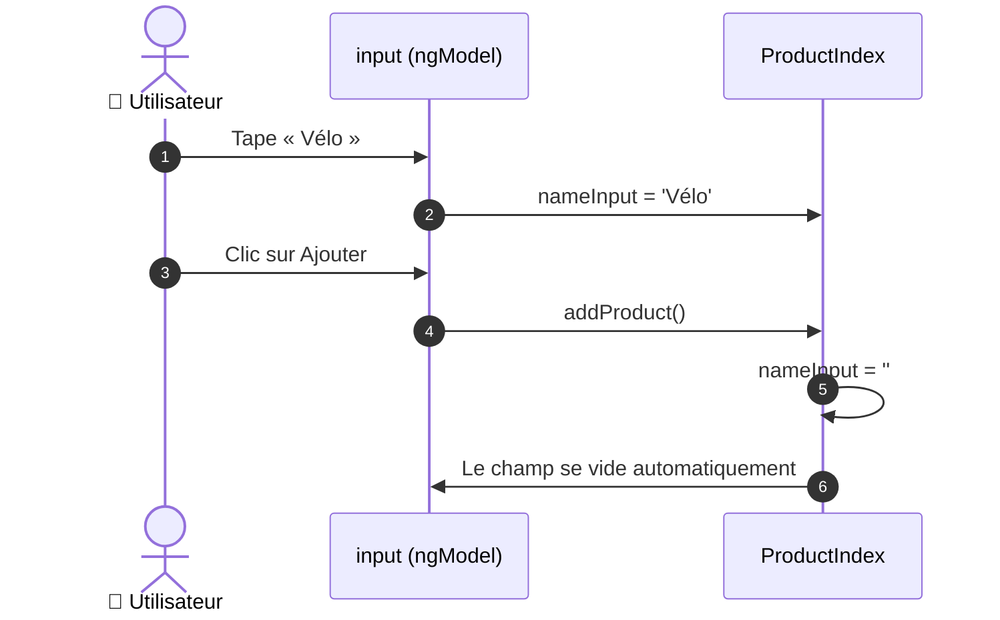
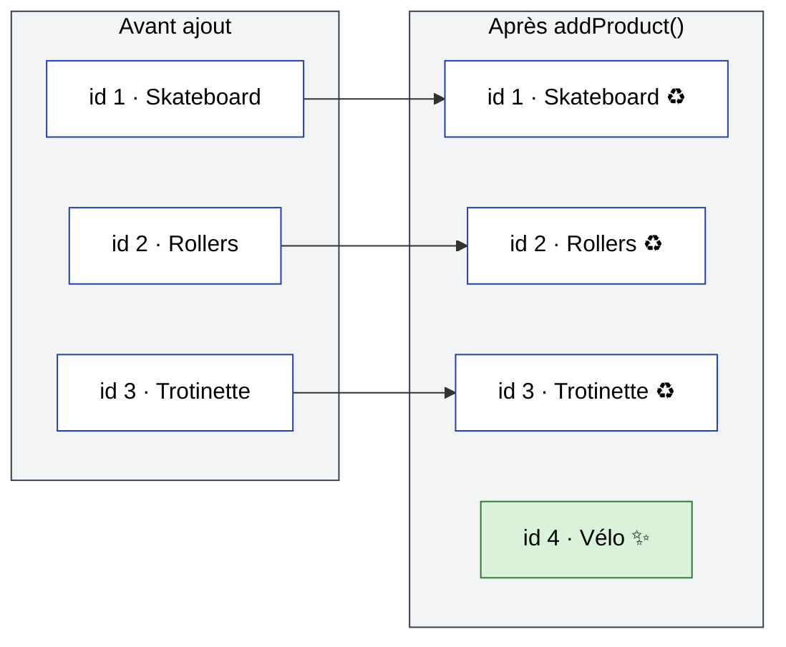
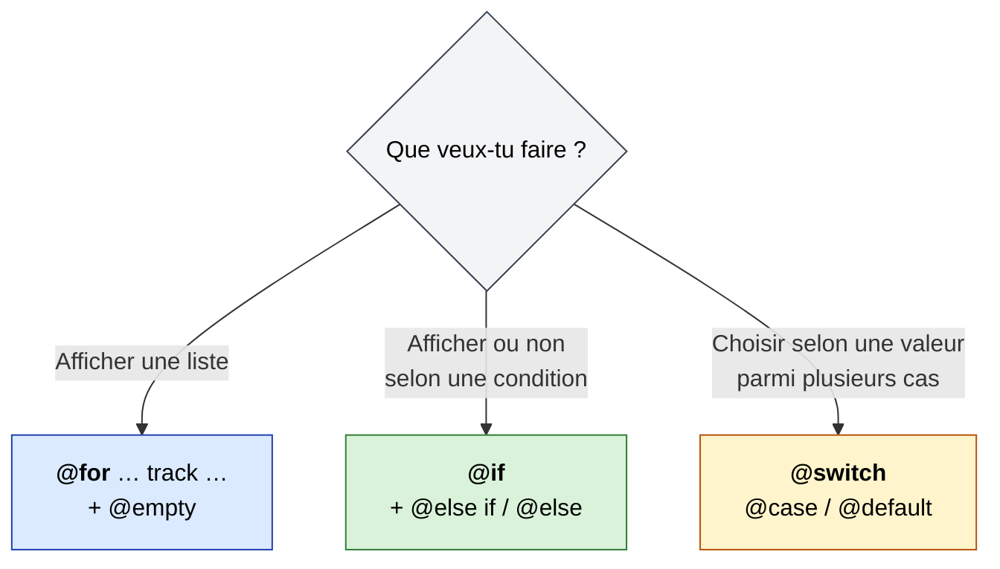
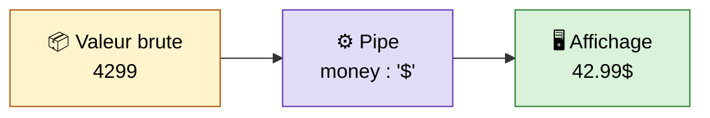
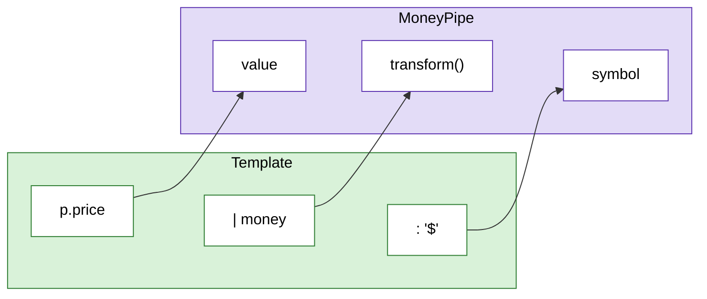
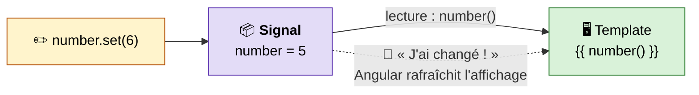
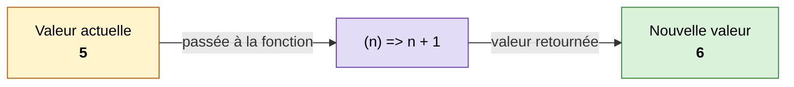
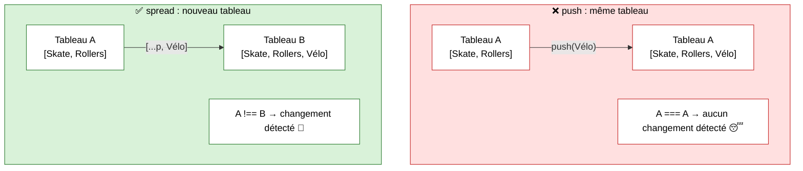

# 02 – Bindings, control flow, pipes et signals

> 🎯 **Objectifs de ce chapitre**
> - Faire communiquer la **classe** d'un composant et son **template** grâce aux *bindings*
> - Connaître les 5 formes de binding : interpolation, **property**, **attribute**, **event**, **two-way** (`ngModel`)
> - Afficher du contenu de façon conditionnelle ou répétée avec **`@if`**, **`@for`**, **`@switch`**
> - Transformer l'affichage d'une valeur avec les **pipes** (natifs et personnalisés)
> - Gérer l'état du composant avec les **WritableSignal** : création, `set()` et `update()`

Fichiers de la démo utilisés dans ce chapitre :

```text
src/app/
├── models/
│   └── product-dto.ts                 ← l'interface ProductDto
├── pipes/
│   └── money-pipe.ts                  ← un pipe personnalisé
└── pages/
    └── product-index/
        ├── product-index.ts           ← la classe (données + méthodes)
        └── product-index.html         ← le template (bindings, @for, pipes)
```

La page est accessible via la route `/product` (lien « Product » de la nav, voir chapitre 01).

---

## 0. Le point de départ : le modèle `ProductDto`

Avant d'afficher des produits, on décrit leur **forme** avec une interface TypeScript :

```ts
// src/app/models/product-dto.ts
export interface ProductDto {
  id: number;
  name: string;
  description?: string;   // ? = propriété optionnelle
  price: number;          // en centimes : 4299 = 42,99
  imageUrl?: string;
}
```

> 💡 **Analogie Java** : une interface TypeScript ressemble à un **DTO** / un `record` Java : elle décrit la structure des données. Mais elle n'existe **qu'à la compilation** : il n'en reste aucune trace dans le JavaScript final. On ne fait donc jamais `new ProductDto()` : on écrit directement un objet `{ id: 1, name: '...', ... }`.

On la génère avec :

```bash
ng g interface models/product-dto
```

---

## 1. Les bindings : relier la classe et le template

Un **binding** (*liaison*) est un pont entre les **données de la classe** (`.ts`) et **l'affichage** (`.html`). Il existe deux sens de circulation :



| Syntaxe | Nom | Sens | Exemple de la démo |
| --- | --- | --- | --- |
| `{{ expr }}` | Interpolation | Classe ➜ Template | `{{ number() }}` |
| `[prop]="expr"` | Property binding | Classe ➜ Template | `[src]="p.imageUrl"` |
| `[attr.x]="expr"` | Attribute binding | Classe ➜ Template | *(exemple plus bas)* |
| `(event)="code"` | Event binding | Template ➜ Classe | `(click)="addProduct()"` |
| `[(ngModel)]="champ"` | Two-way binding | Classe ⇄ Template | `[(ngModel)]="nameInput"` |

> 🧠 **Moyen mnémotechnique**
> - `[ ]` crochets = la donnée **entre** dans le template
> - `( )` parenthèses = l'événement **sort** du template
> - `[( )]` les deux = *« banana in a box »* 🍌📦 → aller-retour

---

### 1.1 L'interpolation `{{ }}`

C'est la forme la plus simple : on affiche une valeur **sous forme de texte**.

```html
<h3>{{ number() }}</h3>
<h3>{{ p.name }}</h3>
```

- Entre les accolades, on écrit une **expression** TypeScript : une propriété, un calcul (`{{ p.price / 100 }}`), un appel de méthode, une concaténation…
- Le résultat est **toujours converti en texte**.
- On n'a accès qu'aux membres **de la classe du composant** (ici `ProductIndex`) et aux variables du template (comme `p` dans un `@for`).

> ⚠️ `number()` avec des **parenthèses** : `number` est un *signal*, et on lit un signal en l'appelant comme une fonction (voir section 4).

> 🔒 Si la valeur contient du HTML (`'<b>Hello</b>'`), Angular l'affiche **tel quel**, sans l'interpréter. C'est une protection contre les injections de script (XSS).

---

### 1.2 Le property binding `[propriété]`

On lie une **propriété DOM** d'un élément à une expression de la classe.

```html

```

Décortiquons cette ligne :

| Partie | Type | Signification |
| --- | --- | --- |
| `[src]="p.imageUrl"` | Binding | La propriété `src` reçoit la **valeur** de `p.imageUrl` |
| `[alt]="'Image de ' + p.name"` | Binding | Une **expression** : concaténation d'un texte (entre `'…'`) et du nom |
| `height="150"` | Attribut HTML classique | La valeur est le texte littéral `"150"`, aucun calcul |

> ⚠️ **Le piège des crochets**
> - `src="p.imageUrl"` → l'image cherche le fichier nommé littéralement… `p.imageUrl` ❌
> - `[src]="p.imageUrl"` → Angular **évalue** l'expression et utilise son résultat ✅
>
> Avec des crochets, le contenu des guillemets est **du code** ; sans crochets, c'est **du texte**.

**Interpolation ou property binding ?** Ces deux lignes sont équivalentes :

```html


```

On préfère `[src]` : l'interpolation convertit toujours en **texte**, alors que le property binding transmet la valeur **avec son type** (booléen, nombre, objet…). C'est indispensable pour une propriété comme `disabled` :

```html
<!-- Le bouton est désactivé tant que le nom est vide -->
<button [disabled]="nameInput === ''" (click)="addProduct()">Ajouter</button>
```

**Cas particuliers bien pratiques :** `[class.xxx]` et `[style.xxx]`

```html
<!-- Ajoute la classe CSS "expensive" seulement si la condition est vraie -->
<p [class.expensive]="p.price > 5000">{{ p.price }}</p>

<!-- Modifie une propriété de style -->
<p [style.color]="p.price > 5000 ? 'red' : 'green'">{{ p.price }}</p>
```

---

### 1.3 L'attribute binding `[attr.xxx]`

#### Propriété DOM ≠ attribut HTML

C'est une nuance importante :



La plupart des attributs ont une propriété DOM correspondante (`src`, `alt`, `disabled`, `value`, `id`…) : on utilise alors le **property binding**.

Mais certains attributs **n'ont pas** de propriété DOM équivalente. Le property binding échoue alors :

```html
<td [colspan]="nbColonnes">…</td>
<!-- ❌ Erreur : Can't bind to 'colspan' since it isn't a known property of 'td' -->
```

Pour ceux-là, on utilise l'**attribute binding**, avec le préfixe `attr.` :

```html
<td [attr.colspan]="nbColonnes">…</td>
```

Exemples courants :

```html
<!-- Accessibilité : les attributs ARIA n'ont pas de propriété DOM -->
<button [attr.aria-label]="'Supprimer ' + p.name">🗑️</button>

<!-- Attributs personnalisés data-* -->
<div [attr.data-product-id]="p.id">…</div>
```

> 💡 Si la valeur vaut `null` ou `undefined`, Angular **retire complètement l'attribut** de l'élément. Pratique pour un attribut conditionnel.

> 🧭 **Règle simple** : utilisez `[propriété]` par défaut. Si Angular répond *« isn't a known property »*, passez à `[attr.propriété]`.

---

### 1.4 L'event binding `(événement)`

On réagit à un **événement** du DOM (clic, saisie, survol…) en appelant du code de la classe.

```html
<button (click)="addProduct()">Ajouter</button>
```

```ts
// product-index.ts
addProduct() {
  this.products.update((p) => [
    ...p,
    {
      id: this.nextId++,
      name: this.nameInput,
      description: this.descriptionInput,
      price: this.priceInput,
      imageUrl: this.imageInput,
    },
  ]);

  // On vide le formulaire
  this.nameInput = '';
  this.descriptionInput = '';
  this.priceInput = 0;
  this.imageInput = '';

  console.log('Product added successfully');
}
```

- Entre parenthèses : le **nom de l'événement DOM**, **sans** le préfixe `on` (`click` et non `onclick`).
- Entre guillemets : le **code** à exécuter, généralement un appel de méthode **avec ses parenthèses** : `addProduct()`.

**Événements courants :** `(click)`, `(dblclick)`, `(input)`, `(change)`, `(submit)`, `(keyup)`, `(focus)`, `(blur)`, `(mouseenter)`, `(mouseleave)`

**Passer des paramètres**

```html
<!-- Une valeur venant du template (ex. l'id du produit dans un @for) -->
<button (click)="removeProduct(p.id)">Supprimer</button>

<!-- L'objet événement lui-même, via la variable spéciale $event -->
<input (input)="onSearch($event)">
```

**Filtrer une touche clavier**

```html
<!-- Ne se déclenche que sur la touche Entrée -->
<input (keyup.enter)="addProduct()">
```

---

### 1.5 Le two-way binding `[(ngModel)]`

Pour un champ de formulaire, on veut souvent les **deux sens** à la fois :
- la classe ➜ le champ : afficher la valeur actuelle (et pouvoir le vider) ;
- le champ ➜ la classe : récupérer ce que l'utilisateur tape.

```html
<div>
  <label for="name">Nom :</label>
  <input type="text" id="name" [(ngModel)]="nameInput">
</div>
<div>
  <label for="price">Prix :</label>
  <input type="number" id="price" [(ngModel)]="priceInput">
</div>
```

```ts
nameInput: string = '';
descriptionInput: string = '';
priceInput: number = 0;
imageInput: string = '';
```



C'est grâce au two-way binding que la remise à zéro `this.nameInput = ''` dans `addProduct()` **vide aussi le champ** à l'écran.

#### ⚠️ Importer `FormsModule`

`ngModel` n'est pas natif : c'est une **directive** fournie par `FormsModule`. Il faut l'importer dans le composant :

```ts
import { FormsModule } from '@angular/forms';

@Component({
  imports: [FormsModule, UpperCasePipe, MoneyPipe],
  ...
})
export class ProductIndex { ... }
```

Sans cet import : `NG8002: Can't bind to 'ngModel' since it isn't a known property of 'input'`.

#### Sous le capot

`[(ngModel)]` n'est qu'un **raccourci** qui combine un property binding et un event binding :

```html
<!-- Ces deux lignes font exactement la même chose -->
<input [(ngModel)]="nameInput">
<input [ngModel]="nameInput" (ngModelChange)="nameInput = $event">
```

> 💡 Avec `type="number"`, `ngModel` convertit automatiquement la saisie en **nombre** : `priceInput` reste bien de type `number`.

> 📝 **Remarque sur la démo** : les prix sont stockés **en centimes** (`4299`). Un prix saisi « 50 » dans le formulaire s'affichera donc `0.50$`. Pour un vrai formulaire, on multiplierait la saisie par 100 dans `addProduct()`.

> 🚀 **Bonus** : `[(ngModel)]` accepte aussi directement un **signal** : `[(ngModel)]="name"` avec `name = signal('')`.

---

## 2. Le control flow : `@if`, `@for`, `@switch`

Ces blocs (appelés *structural directives* ou *control flow*) permettent d'**ajouter ou retirer** des éléments du DOM selon les données. Ils sont **intégrés au langage de template** : aucun import n'est nécessaire.

> 🕰️ Dans du code Angular plus ancien (avant la v17), vous croiserez leurs ancêtres : `*ngIf`, `*ngFor` et `[ngSwitch]`. Ils fonctionnent encore, mais la syntaxe `@` est désormais la norme.

### 2.1 `@for` : répéter un bloc

```html
@for (p of products(); track p.id) {

  <h3>{{ p.name | uppercase }}</h3>
  <p>{{ p.price | money : '$' }}</p>
  

} @empty {

  <p>Pas de produits</p>

}
```

Se lit : *« pour chaque produit `p` du tableau `products()`, affiche ce bloc »*. C'est l'équivalent d'un `for (ProductDto p : products)` en Java.

| Élément | Rôle |
| --- | --- |
| `p of products()` | `p` est la variable de boucle, `products()` le tableau parcouru (un signal, donc avec `()`) |
| `track p.id` | **Obligatoire.** Un identifiant unique pour chaque élément |
| `@empty { … }` | Optionnel. Affiché quand le tableau est **vide** |

#### Pourquoi `track` ?

Quand le tableau change (ajout d'un produit), Angular doit savoir **quels éléments existaient déjà** pour ne recréer que le strict nécessaire dans le DOM.



Grâce à `track p.id`, Angular reconnaît les 3 produits existants (♻️ réutilisés tels quels) et ne crée que le nouveau (✨).

> 🧭 Utilisez **toujours un identifiant unique** (`p.id`). À défaut d'identifiant, `track $index` fonctionne, mais il est moins efficace.

#### Les variables implicites

À l'intérieur d'un `@for`, Angular met à disposition :

| Variable | Valeur |
| --- | --- |
| `$index` | Position de l'élément (commence à 0) |
| `$count` | Nombre total d'éléments |
| `$first` / `$last` | `true` pour le premier / dernier élément |
| `$even` / `$odd` | `true` pour une position paire / impaire |

```html
@for (p of products(); track p.id) {
  <p [class.gris]="$even">{{ $index + 1 }} / {{ $count }} : {{ p.name }}</p>
}
```

### 2.2 `@if` : afficher sous condition

```html
@if (p.price > 5000) {
  <span>💎 Produit premium</span>
} @else if (p.price > 3000) {
  <span>Milieu de gamme</span>
} @else {
  <span>🏷️ Petit prix</span>
}
```

- Si la condition est fausse, le bloc **n'existe pas du tout** dans le DOM (il n'est pas simplement caché).
- `@else if` et `@else` sont optionnels.

Exemple utile : n'afficher l'image **que si** le produit en a une (`imageUrl` est optionnel) :

```html
@if (p.imageUrl) {
  
} @else {
  <p>Pas d'image disponible</p>
}
```

### 2.3 `@switch` : choisir parmi plusieurs cas

Comme un `switch` Java, pour comparer **une valeur** à plusieurs possibilités :

```html
@switch (products().length) {
  @case (0) {
    <p>Aucun produit</p>
  }
  @case (1) {
    <p>Un seul produit</p>
  }
  @default {
    <p>{{ products().length }} produits</p>
  }
}
```

- La comparaison se fait avec `===` (égalité stricte).
- **Pas de `break`** à écrire : un seul `@case` est exécuté.
- `@default` est optionnel.

### 2.4 Quel bloc choisir ?



---

## 3. Les pipes

Un **pipe** transforme une valeur **au moment de l'affichage**, sans modifier la donnée d'origine. On l'applique avec le caractère `|` (*pipe*).

```html
<h3>{{ p.name | uppercase }}</h3>        <!-- Skateboard → SKATEBOARD -->
<p>{{ p.price | money : '$' }}</p>       <!-- 4299 → 42.99$ -->
```



> 💡 `p.price` vaut toujours `4299` dans la classe : seul **l'affichage** change.

### 3.1 Syntaxe

```html
{{ valeur | nomDuPipe }}                       <!-- sans paramètre -->
{{ valeur | nomDuPipe : param1 }}              <!-- avec un paramètre -->
{{ valeur | nomDuPipe : param1 : param2 }}     <!-- plusieurs paramètres -->
{{ valeur | pipe1 | pipe2 }}                   <!-- enchaînement : de gauche à droite -->
```

### 3.2 Les pipes natifs

Ils sont fournis par `@angular/common`. **Chaque pipe utilisé doit être importé** dans le composant :

```ts
import { UpperCasePipe } from '@angular/common';

@Component({
  imports: [FormsModule, UpperCasePipe, MoneyPipe],
  ...
})
```

| Pipe (template) | Classe à importer | Exemple | Résultat |
| --- | --- | --- | --- |
| `uppercase` | `UpperCasePipe` | `{{ 'vélo' \| uppercase }}` | VÉLO |
| `lowercase` | `LowerCasePipe` | `{{ 'VÉLO' \| lowercase }}` | vélo |
| `titlecase` | `TitleCasePipe` | `{{ 'mon vélo' \| titlecase }}` | Mon Vélo |
| `currency` | `CurrencyPipe` | `{{ 42.99 \| currency : 'EUR' }}` | €42.99 |
| `number` | `DecimalPipe` | `{{ 3.14159 \| number : '1.0-2' }}` | 3.14 |
| `percent` | `PercentPipe` | `{{ 0.25 \| percent }}` | 25% |
| `date` | `DatePipe` | `{{ today \| date : 'dd/MM/yyyy' }}` | 15/10/2026 |
| `slice` | `SlicePipe` | `{{ 'Bonjour' \| slice : 0 : 3 }}` | Bon |
| `json` | `JsonPipe` | `{{ p \| json }}` | `{ "id": 1, … }` (idéal pour déboguer) |

> 🌍 Les formats `currency`, `date`, `number` suivent par défaut la locale anglaise (`en-US`). On verra plus tard comment passer en français.

### 3.3 Créer son propre pipe : `MoneyPipe`

```bash
ng g pipe pipes/money
```

Le CLI crée `src/app/pipes/money-pipe.ts`, qu'on complète ainsi :

```ts
// src/app/pipes/money-pipe.ts
import { Pipe, PipeTransform } from '@angular/core';

@Pipe({
  name: 'money',
})
export class MoneyPipe implements PipeTransform {
  transform(value: number, symbol: string = '€'): string {
    return (value / 100).toFixed(2) + symbol;
  }
}
```

| Élément | Rôle |
| --- | --- |
| `@Pipe({ name: 'money' })` | Le nom utilisé **dans le template** : `\| money` |
| `implements PipeTransform` | Contrat (≈ interface Java) qui impose la méthode `transform` |
| `value: number` | 1er paramètre = la valeur **à gauche** du `\|` |
| `symbol: string = '€'` | Paramètres suivants = ceux passés après `:` (ici avec une valeur par défaut) |
| `return …` | Ce qui sera **affiché** |

Correspondance entre template et méthode :



```html
{{ 4299 | money }}          <!-- 42.99€  (symbole par défaut) -->
{{ 4299 | money : '$' }}    <!-- 42.99$ -->
```

Comme un pipe natif, il faut l'**importer** dans le composant qui l'utilise : `imports: [..., MoneyPipe]`.

> 💡 Un pipe est **pur** par défaut : Angular ne rappelle `transform` que si la valeur d'entrée (ou un paramètre) change. C'est donc beaucoup plus performant qu'un appel de méthode `{{ formatPrice(p.price) }}`, qui serait réévalué à chaque rafraîchissement de l'affichage.

---

## 4. Les WritableSignal

### 4.1 Pourquoi des signals ?

Un **signal** est une **boîte qui contient une valeur** et qui **prévient Angular** quand cette valeur change. Angular sait alors exactement quelle partie de l'écran mettre à jour.



Dans la démo, le compteur `number` est incrémenté **chaque seconde** par un `setInterval`, et le `<h3>` se met à jour tout seul :

```ts
constructor() {
  setInterval(() => {
    console.log(this.number());
    this.number.set(this.number() + 1);
  }, 1000);
  ...
}
```

> 🧠 Notre projet tourne en mode **zoneless** (le mode par défaut des versions récentes d'Angular : il n'y a pas de `zone.js` dans `package.json`). Angular ne « devine » plus qu'une donnée a changé : ce sont les **signals** qui le lui disent. Si `number` était un simple `number` modifié dans un `setInterval`, **l'écran ne serait pas mis à jour**.
>
> Les champs `nameInput`, `priceInput`… sont de simples propriétés et fonctionnent quand même : leurs modifications ont lieu pendant un **événement du template** (`(click)`, saisie `ngModel`), après lequel Angular rafraîchit l'affichage.

### 4.2 Instanciation : `signal(valeurInitiale)`

```ts
import { Component, signal, WritableSignal } from '@angular/core';

export class ProductIndex {
  number: WritableSignal<number> = signal(1);
  products: WritableSignal<ProductDto[]> = signal([]);
}
```

- `signal(1)` crée un signal dont la **valeur initiale** est `1`.
- `WritableSignal<number>` est le **type** : un signal *modifiable* qui contient un `number`. Le `<…>` est un **générique**, comme `List<Integer>` en Java.
- L'annotation de type est facultative quand TypeScript peut la deviner :

```ts
number = signal(1);                          // déduit : WritableSignal<number>
products = signal<ProductDto[]>([]);         // [] seul ne suffit pas à deviner le type → on le précise
```

### 4.3 Lecture : `monSignal()`

On lit la valeur en **appelant** le signal comme une fonction :

```ts
console.log(this.number());     // dans la classe
```
```html
<h3>{{ number() }}</h3>                       <!-- dans le template -->
@for (p of products(); track p.id) { … }
```

> ⚠️ **Erreur classique** : oublier les parenthèses. `{{ number }}` affiche la *fonction* signal, pas sa valeur.

### 4.4 Modification avec `set(nouvelleValeur)`

`set()` **remplace** la valeur par une nouvelle :

```ts
this.number.set(10);                     // number vaut maintenant 10
this.number.set(this.number() + 1);      // lit la valeur actuelle, puis la remplace
```

👉 On utilise `set()` quand on connaît **directement** la nouvelle valeur, sans avoir besoin de l'ancienne.

### 4.5 Modification avec `update(fn)`

`update()` reçoit une **fonction** : elle prend la **valeur actuelle** en paramètre et **retourne la nouvelle**.

```ts
this.number.update((n) => n + 1);
```



`this.number.update((n) => n + 1)` est équivalent à `this.number.set(this.number() + 1)` de la démo, en plus concis.

👉 On utilise `update()` quand la nouvelle valeur **dépend de l'ancienne** (incrémenter, ajouter à une liste, retirer d'une liste…).

### 4.6 Signals et tableaux : toujours un **nouveau** tableau

Ajout d'un produit dans la démo :

```ts
this.products.update((p) => [
  ...p,                      // ① on recopie tous les produits existants
  {                          // ② on ajoute le nouveau à la fin
    id: this.nextId++,
    name: 'Skateboard',
    description: "Description d'un skate",
    price: 4299,
    imageUrl: 'https://…',
  },
]);
```

- `p` : le tableau **actuel**
- `[...p, nouveau]` : un **nouveau tableau** contenant les anciens éléments (`...` = *spread operator*, il « étale » les éléments) suivis du nouveau

**Pourquoi ne pas faire simplement `push` ?**

```ts
// ❌ À NE PAS FAIRE
this.products().push(nouveauProduit);
```

Un signal détecte un changement en comparant **la référence** de l'ancienne et de la nouvelle valeur (`ancien === nouveau`). Avec `push`, c'est **le même tableau** qui est modifié : pour le signal, rien n'a changé, et **l'écran ne se met pas à jour**.



Les opérations courantes sur un signal de tableau :

```ts
// Ajouter
this.products.update((p) => [...p, nouveau]);

// Supprimer (par exemple pour implémenter removeProduct)
this.products.update((p) => p.filter((prod) => prod.id !== id));

// Modifier un élément
this.products.update((p) =>
  p.map((prod) => (prod.id === id ? { ...prod, price: 1999 } : prod))
);

// Tout remplacer
this.products.set([]);
```

> 🛠️ **Exercice** : la méthode `removeProduct(id)` de la démo est encore vide. Complétez-la avec la ligne « Supprimer » ci-dessus, puis ajoutez dans le `@for` un bouton `<button (click)="removeProduct(p.id)">Supprimer</button>`.

### 4.7 Résumé : `set` ou `update` ?

| | Lecture | `set(valeur)` | `update(fn)` |
| --- | --- | --- | --- |
| Syntaxe | `monSignal()` | `monSignal.set(10)` | `monSignal.update(v => v + 1)` |
| Rôle | Obtenir la valeur | Remplacer par une valeur connue | Calculer à partir de l'ancienne valeur |
| Exemple démo | `{{ number() }}` | `this.number.set(this.number() + 1)` | `this.products.update(p => [...p, …])` |

> 🔜 Il existe aussi des signals **calculés** (`computed`), dont la valeur dérive d'autres signals, par exemple `nbProduits = computed(() => this.products().length)`. On les verra plus tard.

---

## ✅ À retenir

- **Bindings**
  - `{{ }}` affiche une valeur sous forme de texte.
  - `[prop]` lie une propriété DOM (valeur typée) ; `[attr.x]` sert aux attributs **sans** propriété DOM (`colspan`, `aria-*`, `data-*`).
  - `(event)` appelle une méthode quand un événement se produit ; `$event` donne accès à l'événement.
  - `[(ngModel)]` synchronise un champ dans les **deux sens** et nécessite **`FormsModule`**.
- **Control flow**
  - `@for (x of liste; track x.id) { } @empty { }` : `track` est obligatoire.
  - `@if / @else if / @else` : un bloc absent est **retiré** du DOM.
  - `@switch / @case / @default` : sans `break`.
  - Aucun import nécessaire.
- **Pipes**
  - `{{ valeur | pipe : param }}` transforme **l'affichage** seulement.
  - Les pipes natifs comme les pipes personnalisés doivent être **importés** dans le composant.
  - Un pipe personnalisé = une classe `@Pipe` avec une méthode `transform`.
- **Signals**
  - `signal(initial)` crée un `WritableSignal`.
  - On le **lit** avec `()`, on le **remplace** avec `set()`, on le **calcule à partir de l'ancienne valeur** avec `update()`.
  - Pour un tableau ou un objet, on renvoie toujours une **nouvelle référence** (`[...p, x]`, `filter`, `map`), jamais de `push`.
