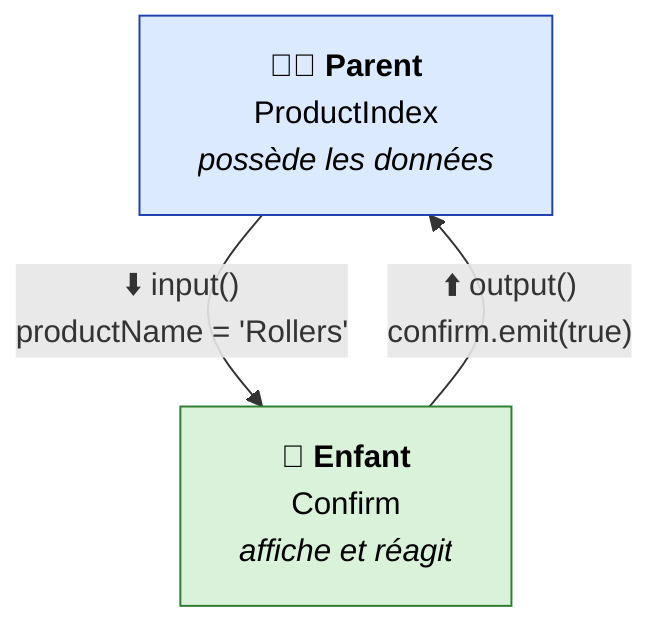
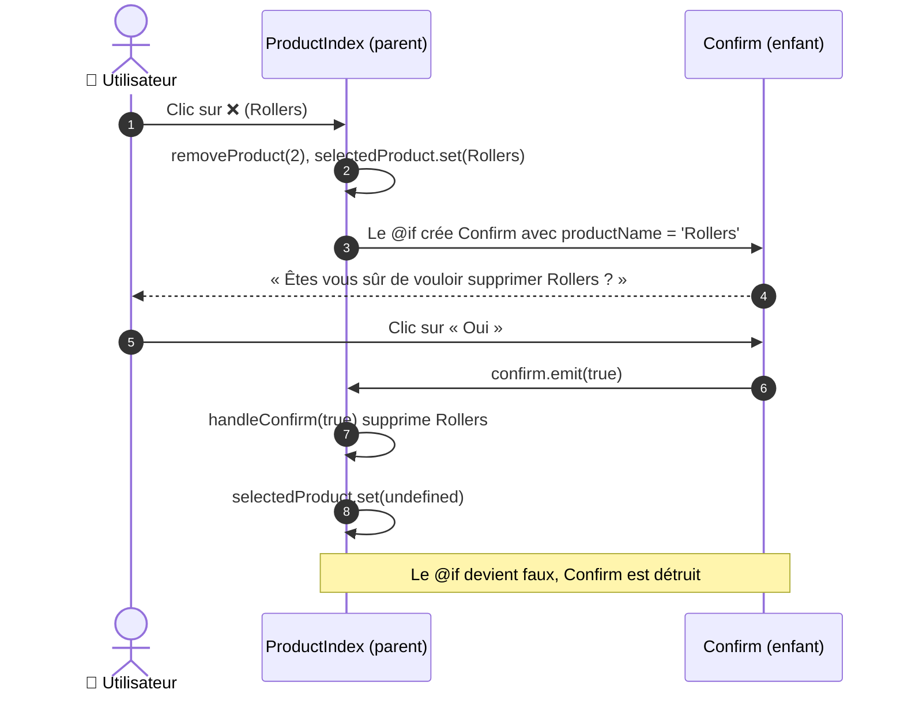
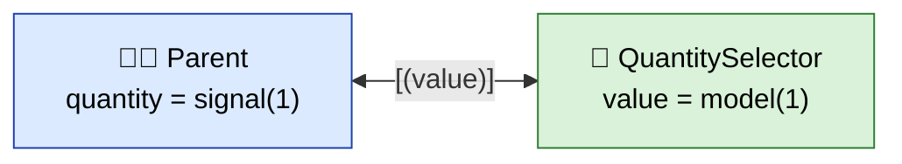
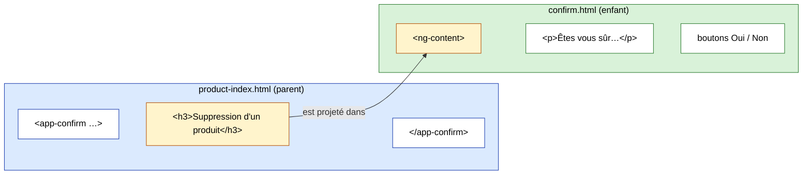
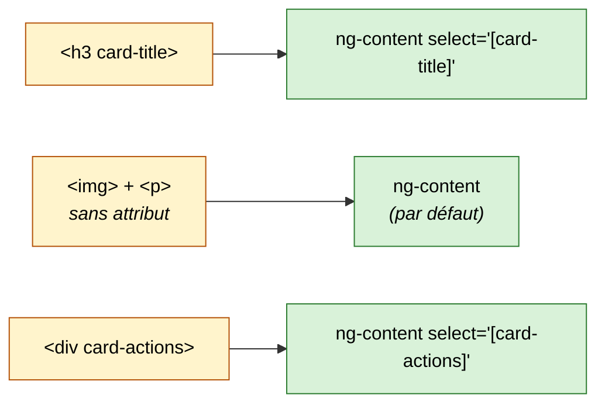
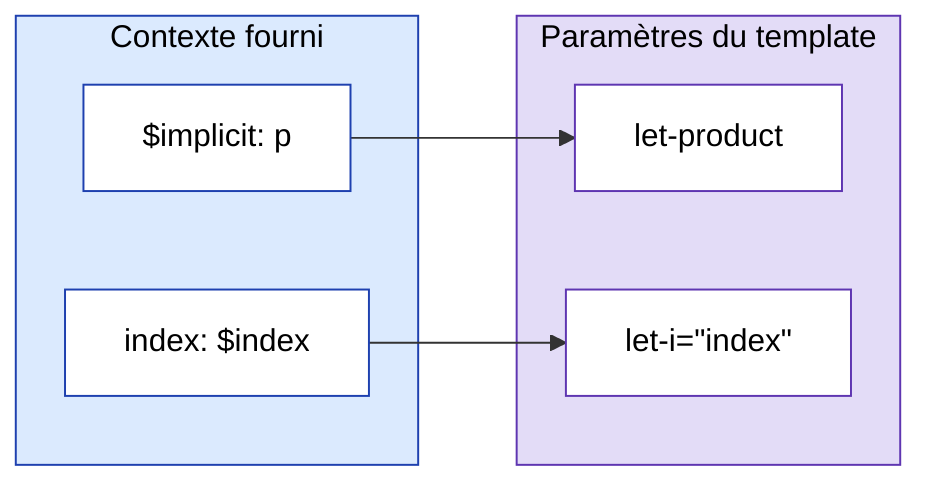
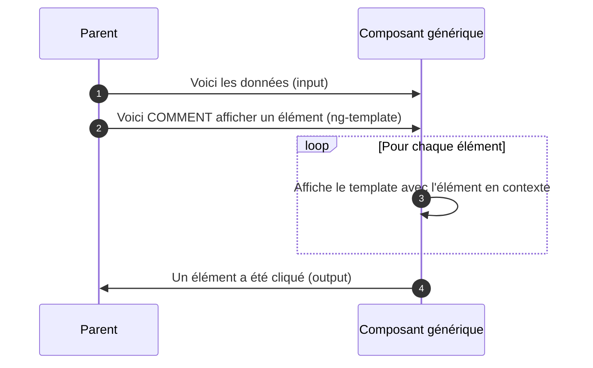
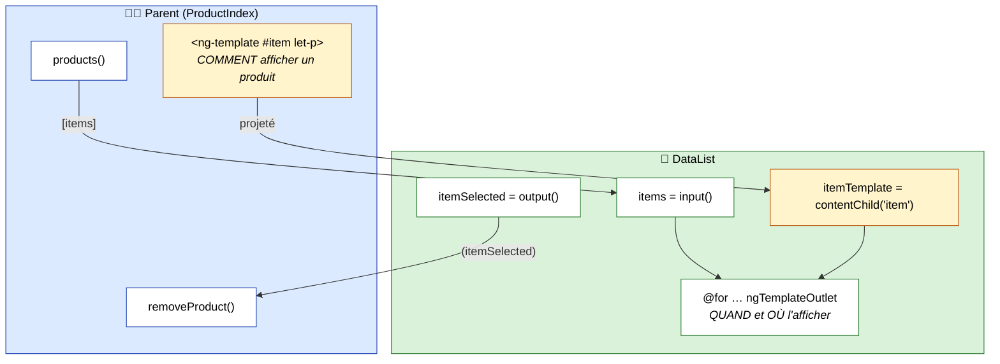
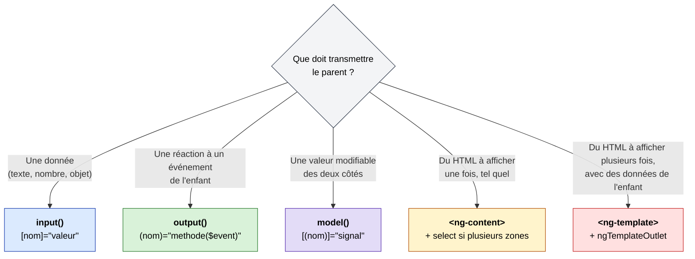

# 03 – Communication entre composants & composants réutilisables

> 🎯 **Objectifs de ce chapitre**
> - Faire communiquer un composant **parent** et un composant **enfant**
> - Transmettre des données au composant enfant avec **`input()`**
> - Remonter des événements au parent avec **`output()`**
> - Synchroniser une valeur dans les deux sens avec **`model()`**
> - Insérer du contenu HTML dans un composant avec **`<ng-content>`** (*content projection*)
> - Rendre un composant **totalement personnalisable** avec **`<ng-template>`** et `ngTemplateOutlet`
> - Construire des composants **réutilisables** concrets : modale, carte, sélecteur de quantité, liste générique

Fichiers de la démo utilisés dans ce chapitre :

```text
src/app/
├── components/
│   └── confirm/                    ← composant ENFANT réutilisable
│       ├── confirm.ts              ← input() + output()
│       ├── confirm.html            ← <ng-content> + emit()
│       └── confirm.scss
└── pages/
    └── product-index/              ← composant PARENT
        ├── product-index.ts        ← selectedProduct, removeProduct(), handleConfirm()
        └── product-index.html      ← <app-confirm [productName] (confirm)>
```

---

## 1. Le problème : deux composants qui doivent se parler

Jusqu'ici, chaque composant vivait **seul** avec ses données. Mais dès qu'on découpe l'interface en petits composants, ils doivent **échanger des informations**.

Dans la démo, quand on clique sur ❌ pour supprimer un produit :
- la **page** `ProductIndex` doit dire à la boîte de dialogue **quel produit** est concerné ;
- la **boîte de dialogue** `Confirm` doit dire à la page **ce que l'utilisateur a répondu** (Oui / Non).



> 🧠 **La règle d'or** : les données **descendent** (inputs), les événements **remontent** (outputs).
> L'enfant ne modifie **jamais directement** les données du parent : il le **prévient**, et c'est le parent qui décide quoi faire.

C'est exactement ce qu'on a déjà vu avec les éléments HTML natifs :

```html
            <!-- [src] : une donnée qui DESCEND vers l'élément -->
<button (click)="addProduct()">     <!-- (click) : un événement qui REMONTE de l'élément -->
```

Avec `input()` et `output()`, **nos propres composants** obtiennent les mêmes super-pouvoirs : on pourra écrire `[productName]="…"` et `(confirm)="…"` sur `<app-confirm>`.

---

## 2. La démo : le composant `Confirm`

### 2.1 Génération

```bash
ng g c components/confirm
```

> 🗂️ **Organisation** : on range dans `components/` les composants **réutilisables** (ni page, ni layout). Ils ne connaissent rien du reste de l'application : tout ce dont ils ont besoin leur est donné par des inputs.

### 2.2 Côté enfant : `confirm.ts`

```ts
import { Component, input, InputSignal, output, OutputEmitterRef } from '@angular/core';

@Component({
  imports: [],
  selector: 'app-confirm',
  styleUrl: './confirm.scss',
  templateUrl: './confirm.html',
})
export class Confirm {
  productName: InputSignal<string> = input.required<string>();
  confirm: OutputEmitterRef<boolean> = output<boolean>();
}
```

| Ligne | Signification |
| --- | --- |
| `input.required<string>()` | « Ce composant **attend** une chaîne `productName` de son parent. Elle est **obligatoire**. » |
| `InputSignal<string>` | Un input est un **signal en lecture seule** : on le lit avec `productName()` |
| `output<boolean>()` | « Ce composant peut **émettre** un événement `confirm` qui transporte un `boolean`. » |
| `OutputEmitterRef<boolean>` | Le type de l'output : il possède une méthode **`emit(valeur)`** |

> 💡 Comme pour les signals, les annotations de type sont facultatives : `productName = input.required<string>();` suffit.

### 2.3 Côté enfant : `confirm.html`

```html
<ng-content></ng-content>
<p>Êtes vous sûr de vouloir supprimer {{ productName() }} ?</p>
<div class="buttons">
  <button (click)="confirm.emit(true)">Oui</button>
  <button (click)="confirm.emit(false)">Non</button>
</div>
```

- `{{ productName() }}` : on **lit** l'input comme n'importe quel signal, avec `()`.
- `confirm.emit(true)` : on **déclenche** l'événement `confirm` en lui donnant la valeur `true`.
- `<ng-content>` : un **trou** dans lequel le parent pourra insérer son propre HTML (voir section 6).

### 2.4 Côté parent : `product-index.html`

```html
@for (p of products(); track p.id) {
  <div class="product-card">
    ...
    <button (click)="removeProduct(p.id)">❌</button>
  </div>
}

@if (selectedProduct()) {
  <app-confirm [productName]="selectedProduct()!.name" (confirm)="handleConfirm($event)">
    <h3>Suppression d'un produit</h3>
  </app-confirm>
}
```

| Partie | Rôle |
| --- | --- |
| `@if (selectedProduct())` | La modale n'existe que lorsqu'un produit est sélectionné |
| `[productName]="…"` | **Property binding** vers l'input `productName` de l'enfant |
| `(confirm)="handleConfirm($event)"` | **Event binding** sur l'output `confirm` de l'enfant |
| `$event` | La valeur passée à `emit()` : ici `true` ou `false` |
| `<h3>Suppression…</h3>` | Contenu **projeté** dans le `<ng-content>` de l'enfant |

> ⚠️ Comme pour tout composant affiché par sélecteur, `Confirm` doit figurer dans les `imports` du parent :
> ```ts
> imports: [FormsModule, UpperCasePipe, MoneyPipe, Confirm],
> ```

### 2.5 Côté parent : `product-index.ts`

```ts
selectedProduct: WritableSignal<ProductDto | undefined> = signal(undefined);

removeProduct(id: number) {
  let p = this.products().find((p) => p.id === id);
  this.selectedProduct.set(p);                       // ① affiche la modale
}

handleConfirm(isConfirm: boolean) {
  if (isConfirm) {
    this.products.update((products) =>
      products.filter(p => p.id !== this.selectedProduct()!.id)   // ② supprime
    );
  }
  this.selectedProduct.set(undefined);               // ③ ferme la modale
}
```

- `ProductDto | undefined` : un **type union**. Le signal contient soit un produit, soit rien.
- Le `!` (*non-null assertion*) dit à TypeScript : « je te garantis que ce n'est pas `undefined` ici ».

### 2.6 Le scénario complet



> 💡 **Astuce** : on peut se passer du `!` grâce à l'alias `as` de `@if`, qui stocke la valeur dans une variable locale déjà vérifiée :
> ```html
> @if (selectedProduct(); as product) {
>   <app-confirm [productName]="product.name" (confirm)="handleConfirm($event)">
>     <h3>Suppression d'un produit</h3>
>   </app-confirm>
> }
> ```

---

## 3. `input()` en détail

### 3.1 Obligatoire ou optionnel ?

```ts
// Obligatoire : le parent DOIT le fournir, sinon erreur de compilation
productName = input.required<string>();

// Optionnel, avec une valeur par défaut
confirmLabel = input<string>('Oui');
cancelLabel = input('Non');                  // type déduit : string

// Optionnel, sans valeur par défaut → peut valoir undefined
subtitle = input<string>();                  // InputSignal<string | undefined>
```

Si on oublie un input obligatoire :

```text
NG8008: Required input 'productName' from component Confirm must be specified.
```

> 🧭 **Comment choisir ?** Obligatoire si le composant **n'a aucun sens** sans cette donnée (le nom du produit à supprimer). Optionnel avec une valeur par défaut pour tout ce qui est **personnalisation** (textes des boutons, couleur, taille…).

### 3.2 Valeur statique ou expression ?

Les règles du chapitre 02 s'appliquent aussi aux inputs :

```html
<!-- Sans crochets : la valeur est le TEXTE littéral -->
<app-confirm confirmLabel="Supprimer" />

<!-- Avec crochets : la valeur est une EXPRESSION évaluée -->
<app-confirm [productName]="product.name" />
```

### 3.3 Un input est en lecture seule

```ts
this.productName.set('autre');   // ❌ Erreur : un InputSignal n'a pas de set()
```

C'est voulu : la donnée **appartient au parent**. Si l'enfant pouvait la modifier, on ne saurait plus qui est responsable de quoi. Pour une valeur modifiable des deux côtés, voir **`model()`** (section 5).

### 3.4 Calculer à partir d'un input : `computed()`

Un input étant un signal, on peut en dériver d'autres valeurs qui se mettront **automatiquement à jour** :

```ts
import { computed, input } from '@angular/core';

export class PriceTag {
  price = input.required<number>();          // en centimes
  discount = input(0);                       // en %

  finalPrice = computed(() => this.price() * (1 - this.discount() / 100));
  isOnSale = computed(() => this.discount() > 0);
}
```

```html
@if (isOnSale()) {
  <s>{{ price() | money }}</s>
}
<strong>{{ finalPrice() | money }}</strong>
```

### 3.5 Transformer la valeur reçue : `transform`

Pour un input booléen, on aimerait écrire simplement `<app-button disabled />`. Problème : sans crochets, la valeur reçue est la chaîne `""`, pas `true`. L'option `transform` règle ça :

```ts
import { booleanAttribute, input, numberAttribute } from '@angular/core';

disabled = input(false, { transform: booleanAttribute });
size = input(1, { transform: numberAttribute });
```

```html
<app-button disabled />          <!-- disabled() vaut true -->
<app-button size="3" />          <!-- size() vaut le NOMBRE 3, pas la chaîne "3" -->
```

### 3.6 Renommer un input : `alias`

```ts
productName = input.required<string>({ alias: 'name' });
```

```html
<app-confirm [name]="product.name" />
```

À utiliser avec modération : avoir le même nom des deux côtés est plus lisible.

---

## 4. `output()` en détail

### 4.1 Émettre une valeur… ou rien

```ts
confirm = output<boolean>();          // transporte un boolean
closed = output<void>();              // ne transporte rien
productSelected = output<ProductDto>(); // transporte un objet
```

```ts
this.confirm.emit(true);
this.closed.emit();
this.productSelected.emit(product);
```

Côté parent, `$event` contient la valeur émise :

```html
<app-product-card (productSelected)="showDetails($event)" />
```

### 4.2 Bonnes pratiques de nommage

| ✅ À faire | ❌ À éviter | Pourquoi |
| --- | --- | --- |
| `(confirm)`, `(closed)`, `(productSelected)` | `(onConfirm)` | Le `on` est implicite dans `(…)` |
| `(valueChange)` | `(click)`, `(change)` | Risque de confusion avec les événements DOM natifs |
| Verbe au passé ou nom d'action | `(doSomething)` | Un output **annonce** ce qui s'est passé, il ne donne pas d'ordre |

### 4.3 Un output n'est pas un signal

Contrairement à `input()`, un `output()` **n'a pas de valeur** à lire : c'est un simple canal par lequel on envoie des événements. On ne fait jamais `this.confirm()`.

---

## 5. `model()` : le two-way binding entre composants

Parfois, une valeur doit pouvoir être modifiée **par le parent ET par l'enfant**. Exemple concret : un **sélecteur de quantité** `[-] 3 [+]`.

Avec `input()` + `output()`, il faudrait tout câbler soi-même. `model()` combine les deux :

```bash
ng g c components/quantity-selector
```

```ts
// quantity-selector.ts
import { Component, input, model } from '@angular/core';

@Component({
  selector: 'app-quantity-selector',
  templateUrl: './quantity-selector.html',
  styleUrl: './quantity-selector.scss',
})
export class QuantitySelector {
  value = model(1);              // ModelSignal<number> : lisible ET modifiable
  min = input(1);
  max = input(99);

  decrement() {
    this.value.update((v) => Math.max(this.min(), v - 1));
  }

  increment() {
    this.value.update((v) => Math.min(this.max(), v + 1));
  }
}
```

```html
<!-- quantity-selector.html -->
<button (click)="decrement()" [disabled]="value() <= min()">−</button>
<span>{{ value() }}</span>
<button (click)="increment()" [disabled]="value() >= max()">+</button>
```

Côté parent, on retrouve la syntaxe « banana in a box » de `ngModel` :

```ts
// parent
quantity = signal(1);
```

```html
<app-quantity-selector [(value)]="quantity" [max]="10" />
<p>Total : {{ (product.price * quantity()) | money }}</p>
```



Quand l'enfant appelle `this.value.update(...)`, le signal `quantity` du parent est **automatiquement** mis à jour, et inversement.

> 💡 **Sous le capot**, `model()` crée un input `value` **et** un output `valueChange`. `[(value)]="quantity"` est un raccourci pour `[value]="quantity()" (valueChange)="quantity.set($event)"`.

### Récapitulatif : `input`, `output`, `model`

| | `input()` | `output()` | `model()` |
| --- | --- | --- | --- |
| Sens | Parent ➜ Enfant | Enfant ➜ Parent | Parent ⇄ Enfant |
| Syntaxe parent | `[nom]="valeur"` | `(nom)="methode($event)"` | `[(nom)]="monSignal"` |
| Lecture dans l'enfant | `nom()` | — | `nom()` |
| Écriture dans l'enfant | ❌ impossible | `nom.emit(valeur)` | `nom.set()` / `nom.update()` |
| Exemple | Nom du produit à afficher | Clic sur « Oui » | Quantité, onglet actif, note ⭐ |

---

## 6. `<ng-content>` : projeter du contenu

### 6.1 Le principe

Un input transmet **une donnée**. Mais comment transmettre **un morceau de HTML** ? Avec la **projection de contenu**.

Tout ce que le parent écrit **entre les balises** du composant enfant est inséré à l'emplacement du `<ng-content>` :



Résultat dans le navigateur :

```html
<app-confirm>
  <h3>Suppression d'un produit</h3>      <!-- vient du parent -->
  <p>Êtes vous sûr de vouloir supprimer Rollers ?</p>
  <div class="buttons">…</div>
</app-confirm>
```

> 💡 Le contenu projeté appartient **au parent** : il utilise les données et les **styles du parent**, pas ceux de l'enfant.

### 6.2 Contenu par défaut

Si le parent ne projette rien, on peut prévoir un contenu de remplacement **à l'intérieur** de `<ng-content>` :

```html
<ng-content>
  <h3>Confirmation</h3>        <!-- affiché seulement si le parent ne fournit rien -->
</ng-content>
```

### 6.3 Plusieurs emplacements : `select`

Un composant peut proposer **plusieurs trous**, chacun ciblant un type de contenu grâce à l'attribut `select` (un sélecteur CSS) :

```html
<!-- card.html -->
<div class="card">
  <header class="card-header">
    <ng-content select="[card-title]" />
  </header>

  <div class="card-body">
    <ng-content />                          <!-- tout le reste -->
  </div>

  <footer class="card-footer">
    <ng-content select="[card-actions]" />
  </footer>
</div>
```

Utilisation :

```html
<app-card>
  <h3 card-title>{{ p.name | uppercase }}</h3>

  
  <p>{{ p.price | money }}</p>

  <div card-actions>
    <button (click)="removeProduct(p.id)">❌</button>
  </div>
</app-card>
```



| `select="…"` | Capture |
| --- | --- |
| `[card-title]` | Les éléments qui ont l'attribut `card-title` |
| `h3` | Les balises `<h3>` |
| `.footer` | Les éléments de classe `footer` |
| `app-icon` | Les composants `<app-icon>` |
| *(pas de select)* | Tout ce qui n'a été capturé par aucun autre `ng-content` |

### 6.4 Les limites de `<ng-content>`

`<ng-content>` est simple et efficace, mais :
- le contenu projeté est affiché **une seule fois** : impossible de le répéter dans un `@for` ;
- l'enfant ne peut **pas lui passer de données** (impossible de dire « affiche ce bloc pour *ce* produit ») ;
- le contenu est **toujours créé** par le parent, même s'il est placé dans un `@if` faux côté enfant.

👉 Pour aller plus loin, il faut **`<ng-template>`**.

---

## 7. `<ng-template>` : un modèle de HTML réutilisable

### 7.1 Le principe

Un `<ng-template>` est un morceau de HTML **qui n'est pas affiché** : c'est un **modèle**, un « moule », qu'on pourra afficher **plus tard**, **où on veut**, **autant de fois qu'on veut**, et **avec les données qu'on veut**.

```html
<ng-template #productTpl>
  <p>Je ne suis PAS affiché tant qu'on ne me le demande pas.</p>
</ng-template>
```

- `#productTpl` est une **variable de référence de template** : elle donne un nom au modèle pour pouvoir l'utiliser ailleurs.

> 💡 **Analogie Java** : `<ng-content>` revient à passer un **objet déjà construit**, alors que `<ng-template>` revient à passer **une méthode** (une lambda) que l'enfant appelle quand il veut, avec les paramètres qu'il veut.

### 7.2 Afficher un template : `ngTemplateOutlet`

La directive `NgTemplateOutlet` (de `@angular/common`) affiche un template à un endroit donné. On l'utilise généralement sur un **`<ng-container>`**, une balise « fantôme » qui ne crée aucun élément dans le DOM :

```ts
import { NgTemplateOutlet } from '@angular/common';

@Component({
  imports: [NgTemplateOutlet],
  ...
})
```

```html
<ng-template #hello>
  <p>Bonjour 👋</p>
</ng-template>

<ng-container [ngTemplateOutlet]="hello" />
<ng-container [ngTemplateOutlet]="hello" />   <!-- affiché une 2e fois ! -->
```

### 7.3 Passer des données à un template : le contexte

C'est là que `ng-template` devient vraiment puissant : on peut lui **fournir des données**, comme des paramètres de fonction.

```html
<!-- Le modèle déclare ses paramètres avec let- -->
<ng-template #productTpl let-product let-i="index">
  <p>{{ i + 1 }}. {{ product.name }} – {{ product.price | money }}</p>
</ng-template>

<!-- On l'affiche en lui passant un contexte -->
@for (p of products(); track p.id) {
  <ng-container
    [ngTemplateOutlet]="productTpl"
    [ngTemplateOutletContext]="{ $implicit: p, index: $index }" />
}
```



| Côté contexte | Côté template | Règle |
| --- | --- | --- |
| `$implicit: p` | `let-product` | `let-xxx` **sans valeur** reçoit la propriété spéciale `$implicit` |
| `index: $index` | `let-i="index"` | `let-xxx="cle"` reçoit la propriété `cle` du contexte |

> 💡 Écriture alternative, plus compacte, avec la syntaxe « étoile » :
> ```html
> <ng-container *ngTemplateOutlet="productTpl; context: { $implicit: p, index: $index }" />
> ```

### 7.4 Le vrai super-pouvoir : passer un template à un composant enfant

Le parent peut **donner un template à l'enfant**, et c'est **l'enfant** qui décide quand et avec quelles données l'afficher. C'est la clé des composants **réutilisables à souhait**.



Il existe deux façons de transmettre le template. On les voit en détail dans l'exemple 8.3.

| | Via un **input** | Via **`contentChild`** |
| --- | --- | --- |
| Côté parent | `<ng-template #tpl>` **à côté**, puis `[itemTemplate]="tpl"` | `<ng-template #item>` **à l'intérieur** des balises de l'enfant |
| Côté enfant | `itemTemplate = input<TemplateRef<…>>()` | `itemTemplate = contentChild<TemplateRef<…>>('item')` |
| Avantage | Explicite, le template peut être réutilisé ailleurs | Syntaxe plus naturelle, proche de `ng-content` |

---

## 8. Exemples concrets de composants réutilisables

### 8.1 Une modale générique (évolution de `Confirm`)

Notre `Confirm` actuel fonctionne, mais il n'est **pas vraiment réutilisable** : le texte *« Êtes vous sûr de vouloir supprimer … ? »* est **écrit en dur**. Impossible de l'utiliser pour confirmer une déconnexion ou l'envoi d'un formulaire.

**Version réutilisable :**

```ts
// components/confirm/confirm.ts
import { Component, input, output } from '@angular/core';

@Component({
  selector: 'app-confirm',
  templateUrl: './confirm.html',
  styleUrl: './confirm.scss',
})
export class Confirm {
  title = input('Confirmation');
  confirmLabel = input('Oui');
  cancelLabel = input('Non');

  confirm = output<boolean>();
}
```

```html
<!-- components/confirm/confirm.html -->
<div class="backdrop" (click)="confirm.emit(false)"></div>

<div class="dialog">
  <h3>{{ title() }}</h3>

  <div class="dialog-body">
    <ng-content />                            <!-- le message, fourni par le parent -->
  </div>

  <div class="buttons">
    <button (click)="confirm.emit(true)">{{ confirmLabel() }}</button>
    <button (click)="confirm.emit(false)">{{ cancelLabel() }}</button>
  </div>
</div>
```

```scss
// components/confirm/confirm.scss
.backdrop {
  position: fixed;
  inset: 0;                               // couvre tout l'écran
  background-color: rgba(0, 0, 0, 0.5);   // voile sombre
}

.dialog {
  position: fixed;
  top: 50%;
  left: 50%;
  transform: translate(-50%, -50%);
  background-color: white;
  padding: 2rem;
}
```

> 💡 Un clic sur le voile sombre (en dehors de la boîte) équivaut à « Non » : c'est le comportement attendu d'une modale.

Utilisations dans des contextes **complètement différents** :

```html
<!-- Suppression d'un produit -->
@if (selectedProduct(); as p) {
  <app-confirm title="Suppression d'un produit" confirmLabel="Supprimer" (confirm)="handleConfirm($event)">
    <p>Êtes-vous sûr de vouloir supprimer <strong>{{ p.name }}</strong> ?</p>
  </app-confirm>
}

<!-- Déconnexion -->
@if (askLogout()) {
  <app-confirm title="Déconnexion" (confirm)="logout($event)">
    <p>Voulez-vous vraiment vous déconnecter ?</p>
  </app-confirm>
}
```

> 🧭 **Principe** : un composant réutilisable ne contient **aucun texte ni aucune donnée métier en dur**. Tout ce qui peut varier devient un **input** ou du **contenu projeté**.

### 8.2 Une carte avec emplacements (`ng-content select`)

Le bloc `.product-card` de `product-index.html` mélange **structure** (bordure, espacement, disposition) et **contenu** (nom, prix, image). On peut extraire la structure dans un composant `Card` réutilisable partout (produits, utilisateurs, articles…).

```bash
ng g c components/card
```

```html
<!-- components/card/card.html -->
<article class="card">
  <header>
    <ng-content select="[card-title]" />
  </header>

  <section>
    <ng-content />
  </section>

  <footer>
    <ng-content select="[card-actions]" />
  </footer>
</article>
```

```scss
// components/card/card.scss
.card {
  display: flex;
  flex-direction: column;
  gap: 1rem;
  border: 1px solid #ccc;
  padding: 1.5rem;

  footer:empty {
    display: none;          // pas d'actions fournies → pas de footer
  }
}
```

```html
<!-- product-index.html -->
@for (p of products(); track p.id) {
  <app-card>
    <h3 card-title>{{ p.name | uppercase }}</h3>

    
    <p>{{ p.price | money : '$' }}</p>

    <button card-actions (click)="removeProduct(p.id)">❌</button>
  </app-card>
}
```

### 8.3 Une liste générique (`ng-template` + `contentChild`)

Objectif : un composant `DataList` qui gère **tout le comportement commun** d'une liste (affichage, message si vide, numérotation, sélection), mais qui laisse **le parent décider** de l'apparence de chaque élément.

```bash
ng g c components/data-list
```

```ts
// components/data-list/data-list.ts
import { Component, contentChild, input, output, TemplateRef } from '@angular/core';
import { NgTemplateOutlet } from '@angular/common';

@Component({
  selector: 'app-data-list',
  imports: [NgTemplateOutlet],
  templateUrl: './data-list.html',
  styleUrl: './data-list.scss',
})
export class DataList<T> {
  items = input.required<T[]>();
  emptyMessage = input('Aucun élément');

  itemSelected = output<T>();

  // Récupère le <ng-template #item> placé par le parent entre les balises
  itemTemplate = contentChild<TemplateRef<{ $implicit: T; index: number }>>('item');
}
```

```html
<!-- components/data-list/data-list.html -->
<ul>
  @for (item of items(); track item) {
    <li (click)="itemSelected.emit(item)">
      @if (itemTemplate(); as tpl) {
        <ng-container
          [ngTemplateOutlet]="tpl"
          [ngTemplateOutletContext]="{ $implicit: item, index: $index }" />
      } @else {
        {{ item }}                          <!-- affichage par défaut -->
      }
    </li>
  } @empty {
    <li class="empty">{{ emptyMessage() }}</li>
  }
</ul>
```

> 💡 `DataList<T>` est un composant **générique**, comme une classe `List<T>` en Java : il fonctionne avec des produits, des utilisateurs, des chaînes…

**Utilisation 1 : liste de produits**

```html
<app-data-list
  [items]="products()"
  emptyMessage="Pas de produits"
  (itemSelected)="removeProduct($event.id)">

  <ng-template #item let-p let-i="index">
    <strong>{{ i + 1 }}.</strong> {{ p.name | uppercase }} – {{ p.price | money }}
  </ng-template>

</app-data-list>
```

**Utilisation 2 : la même liste, un tout autre rendu**

```html
<app-data-list [items]="products()" (itemSelected)="showDetails($event)">

  <ng-template #item let-p>
    
    <span>{{ p.name }}</span>
  </ng-template>

</app-data-list>
```

**Utilisation 3 : sans template, avec des chaînes**

```html
<app-data-list [items]="['Angular', 'Spring', 'Java']" />
```



**Variante : passer le template par un input**

```ts
// data-list.ts
itemTemplate = input<TemplateRef<{ $implicit: T; index: number }>>();
```

```html
<!-- parent : le template est déclaré À CÔTÉ du composant -->
<ng-template #productLine let-p>
  {{ p.name }} – {{ p.price | money }}
</ng-template>

<app-data-list [items]="products()" [itemTemplate]="productLine" />
<app-data-list [items]="favorites()" [itemTemplate]="productLine" />   <!-- même template réutilisé -->
```

### 8.4 Un état « chargement / erreur / vide » réutilisable

Un besoin très fréquent quand on appelle une API : afficher un spinner pendant le chargement, un message en cas d'erreur, et le contenu sinon. Plusieurs `ng-template` optionnels permettent de personnaliser chaque état :

```ts
// components/async-state/async-state.ts
import { Component, contentChild, input, TemplateRef } from '@angular/core';
import { NgTemplateOutlet } from '@angular/common';

@Component({
  selector: 'app-async-state',
  imports: [NgTemplateOutlet],
  templateUrl: './async-state.html',
})
export class AsyncState {
  loading = input(false);
  error = input<string | null>(null);

  loadingTpl = contentChild<TemplateRef<unknown>>('loading');
  errorTpl = contentChild<TemplateRef<{ $implicit: string }>>('error');
}
```

```html
<!-- components/async-state/async-state.html -->
@if (loading()) {
  @if (loadingTpl(); as tpl) {
    <ng-container [ngTemplateOutlet]="tpl" />
  } @else {
    <p>⏳ Chargement…</p>
  }
} @else if (error()) {
  @if (errorTpl(); as tpl) {
    <ng-container [ngTemplateOutlet]="tpl" [ngTemplateOutletContext]="{ $implicit: error() }" />
  } @else {
    <p class="error">❌ {{ error() }}</p>
  }
} @else {
  <ng-content />
}
```

```html
<!-- Utilisation simple : les rendus par défaut suffisent -->
<app-async-state [loading]="isLoading()" [error]="errorMessage()">
  <app-data-list [items]="products()" />
</app-async-state>

<!-- Utilisation personnalisée : on remplace le rendu de l'erreur -->
<app-async-state [loading]="isLoading()" [error]="errorMessage()">
  <ng-template #error let-message>
    <div class="alert">Impossible de charger les produits : {{ message }}</div>
  </ng-template>

  <app-data-list [items]="products()" />
</app-async-state>
```

> 💡 On combine ici les deux mécanismes : des **`ng-template`** pour les états personnalisables, et **`<ng-content>`** pour le contenu principal.

> ⚠️ Rappel de la limite 6.4 : le contenu de `<ng-content>` (ici `<app-data-list>`) est créé **même pendant le chargement**, simplement non affiché. Pour un contenu lourd, on le placerait lui aussi dans un `ng-template`.

---

## 9. Quel outil choisir ?



### Checklist d'un bon composant réutilisable

- [ ] Rangé dans `components/`, **sans dépendance** à une page précise
- [ ] **Aucun texte métier en dur** : tout ce qui varie est un `input()` (avec une valeur par défaut raisonnable) ou du contenu projeté
- [ ] Ne modifie **jamais** les données du parent : il **émet** des `output()`
- [ ] Les inputs indispensables sont **`input.required`**
- [ ] Fournit un **rendu par défaut** quand un template optionnel n'est pas fourni
- [ ] Son style ne dépend pas de l'endroit où il est utilisé (tout passe par `:host` et ses propres classes)

---

## ✅ À retenir

- **`input()`** : la donnée **descend** du parent vers l'enfant. C'est un signal en **lecture seule** (`nom()`). Il peut être obligatoire (`input.required`), avoir une valeur par défaut, un `transform` ou un `alias`.
- **`output()`** : l'événement **remonte** de l'enfant vers le parent avec `nom.emit(valeur)`. Le parent récupère la valeur avec `$event`.
- **`model()`** : une valeur partagée dans les **deux sens**, avec la syntaxe `[(nom)]`.
- **`<ng-content>`** : le parent insère du HTML **entre les balises** de l'enfant. `select` permet de créer plusieurs emplacements.
- **`<ng-template>`** : un modèle HTML **non affiché** qu'on rend avec `ngTemplateOutlet`, **autant de fois** qu'on veut, avec un **contexte** (`$implicit`, `let-…`).
- Un parent peut **donner un template à un enfant** (`input<TemplateRef>()` ou `contentChild`) : l'enfant gère le **comportement**, le parent garde le contrôle de l'**apparence**.
- Tout composant utilisé dans un template doit être dans les **`imports`** du parent, et `NgTemplateOutlet` dans ceux de l'enfant qui l'utilise.
